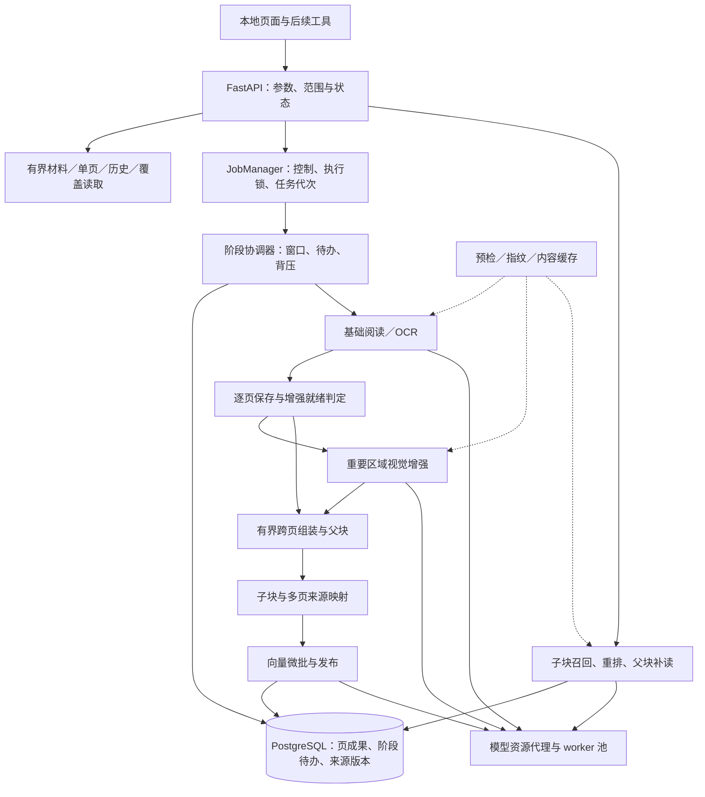

# P1 实施方案

设计日期：2026-10-24；开发交接细化：2026-10-26。当前先做稳本地 RAG。2026-11-07 起，报告编排不在本仓库接回 Harness；项目中心的页面、格式和隔离方案见 [project-center-plan.md](./project-center-plan.md)。tasks.md 是唯一任务状态／认领入口；本文件定义目标架构与接口，不维护第二套待办。

## 性能开发交接：现状与目标

现状（2026-11-02）：已具备持久阶段队列、阶段暂停／恢复、有界窗口与背压、短事务／连接复用、共享驻留模型运行时、查询公平调度及纯模型缓存。父子索引的发布／恢复／局部修复与受控 shadow 模式完成限定工程验收，默认 off；生产查询仍走旧页级索引。下一步是父子查询、微批／跨 job 计划复用、图像复用、缓存生命周期及联合性能验收。下表“新”表示相对最初设计新增，是否交付以 tasks.md 为准，不得把目标图等同于当前运行能力。

实线表示职责调用／数据流，不表示允许所有推理同时执行。一个持有执行权的协调器内部可以调度多个阶段；模型并发由资源预算决定。增强未就绪页形成临时缺口，组装仅消费就绪连续段，不能从图中误读为未增强文字直接当最终证据。

### 模块与写入所有权

下表是建议落点，不要求一次重写全部现有服务。新增模块先提供可独立验证的契约，再由认领的集成者接入公共文件；所有路径均相对项目根目录。

| 职责／建议模块 | 主要入口与输出 | 归属任务／集成边界 |
| --- | --- | --- |
| `src/dd_agent/cache.py`（新） | FingerprintRegistry、PreflightCache；返回摘要／预检、命中与验证模式 | RG-05b；reading/review/retrieval 的摘要调用由同一任务统一接入 |
| `src/dd_agent/page_queries.py`（新） | 材料／页目录、单页、最新结果、历史的有界查询 | RG-05g1；db.py 可保留兼容薄入口 |
| `src/dd_agent/db_connections.py`（新） | 普通短连接作用域与独立队列租约连接 | RG-05h；app.py 组合时注入共享 provider，CLI 显式关闭 |
| `src/dd_agent/stage_jobs.py`（新） | 阶段待办创建、领取、版本／代次检查和完成 | RG-05c；不在此模块加载任何模型 |
| `src/dd_agent/pipeline.py` | 父任务控制、窗口调度、就绪集合、恢复／背压 | RG-05d；保留外部队列控制入口，逐步替换串行 run |
| `src/dd_agent/model_runtime.py`（新） | 资源租约、worker 状态、请求 ID 与加载／空闲回收 | RG-05e；LocalModels／LocalVision／Reader 只做客户端适配 |
| `src/dd_agent/assembly.py`（新） | 版本化页快照 → 父块、尾段状态、source_spans／边界依赖 | RG-06a；规则和持久化边界分开，不自行创建向量 |
| `src/dd_agent/retrieval.py` | 子块发布、候选查询、来源复验和父块补读 | RG-06b／c 与 RG-05i；按任务串行集成共享区 |
| `src/dd_agent/embedding_batches.py`（新） | 跨页微批、长度桶、文本向量缓存和结果归位 | RG-05j；不修改父块归属／原始证据身份 |
| `src/dd_agent/image_artifacts.py`（新） | 渲染成果／缩略图／裁剪缓存及图像版本 | RG-05k；正文 OCR 图与浏览缩略图分开 |
| `src/dd_agent/artifact_cleanup.py`（新） | 占用清单、保留引用、dry-run 与有界清理 | RG-05l；先接缓存生命周期，不扫描删除业务原件 |
| `src/dd_agent/performance.py`、`testing/` | 沿用已完成阶段观测，补充各优化前后证据 | 各任务使用；指标语义变更须由集成人统一处理 |

### K01 Cache

目标入口：`resolve_fingerprint(kind, runtime_descriptor, algorithm_tag, parameters, verify=False)` 与 `inspect_document(document_identity, parser_version, verify=False)`。输出含 `value`、`cache_hit`、`validation_mode`、`manifest_revision`；不返回模型实例。`verify=True` 必须重新完整校验内容，不被缓存短路。

缓存存配置数据目录 `cache/fingerprints/`、`cache/preflight/`，按种类／键独立 JSON，临时文件原子替换；内存只作有界加速，不作恢复依据。并发未命中使用单键锁并在获锁后重查；损坏／缺失退回复算。键包含算法标记、所有实际参数、模型文件清单、解释器及依赖运行时版本；保留现有摘要算法的位级一致性，不因抽取缓存层就改变已有 reading／index version。

快速路径前提是经过完整校验的受控模型版本；文件清单／身份、大小、时间等变化使其失效。目录名、TTL 或 mtime 不能单独证明内容相同。同元数据原地改写无法由快检可靠识别时，必须走完整复验或拒绝该版本的可信复用；不得声称元数据检查等价于内容 hash。模型激活／替换策略及严格复验入口须随 RG-05b 交付说明。

预检键基于项目内材料身份、原件 SHA-256 和解析版本；缓存不复制正文。空向量批直接发布零片段页状态，混合批只传非空文字；未知／失败不得伪装空白。读取本批成功页状态时先用字段投影，避免先取全卷正文再判断跳过。

### K02 Page Reads

建议新增同一项目／材料前缀下的 `GET page-catalog`、`GET pages/{number}`、`GET pages/{number}/history`；原有 image 路径保留，改为 SQL 单页定位。材料清单接现有 material-catalog。目录默认 50／最大 100，历史默认 10／最大 50；单页正文一次最多 100,000 字符，超出用同版本偏移续读，不静默截断。

目录返回 `items / next_cursor / content_revision / status_revision / as_of`，不含正文、行框或内部存储路径；单页按 `view=raw|effective` 返回来源版本、文字、质量及按需行框。页目录按物理页号 keyset 续读，绑定项目／材料／排序／reading_version；同阅读版本下新增已完成页不必使所有目录游标失效，注明非冻结快照。正文偏移续读必须绑定 source_revision，变化后明确拒绝。`page=600` 深链接应直接取单页和附近目录，不遍历前 599 页。

先新增接口兼容旧前端，再由 g2 切换，最后限制旧无界接口：超过其安全范围时明确返回 `bounded_read_required` 和新入口，不静默返回残缺数组。纯进度变化不更换 content_revision；内容、有效来源或图像变化必须失效对应缓存。目标错误映射：not_found／wrong_project／missing_artifact 为 404，not_processed／stale／bounded_read_required 为 409，busy 为 503，timeout 为 504，参数错误为 422；越项目使用“不存在或不属于当前项目”的统一提示。服务层返回领域错误，由 API 适配为状态码，不依赖 HTTPException。

K02 复审修复补充：正文与原始文字各绑定来源版本；content_revision 变化后先取选中页目录项核对，再决定正文／当前增强摘要是否失效。`GET pages/{number}/summary` 绑定 source_revision，只返回实际生效结果的 outcome／route／regions 和历史数量，不复制正文或全历史；历史详情展开才请求分页预览（每批替换显示），基础文字详情展开才请求 raw。历史 is_current 绑定有效视图实际选中的机器记录，而不是只比基础修订，base_matches_current 单独表示基础版本匹配。正文、原文和摘要缓存各限一页，目录请求有代次保护，轮询同一时刻仅有一条在途链，重复触发合并执行。旧 automatic／review 接口仅保留兼容，新阅读器不调用它们。

### K03 Database

保持 `with database.connect() as conn` 调用形式；引入 provider 而不是每个 Database 对象各建一套池。Web 组合入口创建并注入共享 provider，默认普通连接上限试验起点 4、协调器专用租约连接 1；CLI 用显式作用域关闭。未配置／不可达数据库仍能打开诊断页，不在构造函数里无限等待。

队列 session advisory lock 的连接独立创建、显式解锁关闭，不归还普通连接池。保留 74332103 执行权和 74332104 控制串行化含义；模型计算不持页面写锁，SQL／发布事务有界。锁顺序统一为材料当前版本 → 升序页号 → 组装修订；涉及新表时在迁移说明中固定次序。池等待超时与数据库不可达分别记录。

RG-05h 实现：`ConnectionProvider` 使用 psycopg-pool，最小连接数 0、默认最大 4、等待 3 秒、等待队列最大 8；组合入口只创建一个 provider，Reader／Review／Automatic／Evidence／Pipeline／JobManager 共用。`Database.connect()` 正常提交／异常回滚，归还时清理 session 锁与设置；队列改用 `Database.lease()` 独立连接。查询覆盖读取、向量生成、召回、重排序、最终来源校验分别完成，推理不跨数据库事务。CLI 用 `database_scope()` 显式收尾。停机先请求后台保存，再关闭池；在途后台迟到检查点及作用域外旧调用用短连接，避免丢保存，故 4＋1 是正常运行期每进程预算。逐页发布事务与原有锁顺序保留；128 行写入对照未显示稳定批处理收益，暂不改成跨页批量提交。隔离库上 40 次轻量读取的中位数从 1.801 秒降到 0.065 秒。

### K04 Stage Work

RG-05c 实施边界：007 添加 stage_jobs、stage_attempts、page_outbox、stage_deliveries，以及父任务 run_epoch／stage_cursor。基础页和机器页的成功写入由数据库触发器同事务记录下游来源事件；迁移为历史成功页补齐事件。reconcile 每次最多处理 100 条未投递事件，以父任务＋代次＋事件 ID 的账本去重，账本和任务创建原子提交；stage_cursor 仅记录观测位置，不用它排除事件，因为序号分配不等于提交顺序。模型／组装策略由调用者传入 policy_version，与来源、范围和前置阶段输入共同生成 input_revision；缺少策略时停在待对账，不猜模型版本。父任务 enqueue 原子建立 preflight，明确 resume 递增代次，取消旧的非终态任务；新代次重新对账，同输入成功成果仍可复用。claim 用短事务领取，complete 的数据库发布回调必须在 parent → reading → 升序页 → stage 锁及 owner／来源校验后执行。重试最多 3 次（允许显式 1–5），保留每次尝试的分类错误。此项接入持久生产者和仓储，原五页串行处理逻辑保留；阶段消费者、十页窗口和并行背压由 RG-05d 切换，不能声称本项已经加速流水线。

保留 processing_jobs 为父任务；新增阶段待办表，至少包含 `job_id / project_id / document_id / stage / scope / scope_key / input_revision / run_epoch / owner_token / state / attempts / available_at`。stage 统一为 preflight／reading／vision／assembly／embedding；scope 保存页范围等结构，scope_key 是规范化范围的稳定摘要，避免直接索引大 JSON。唯一键约束父任务＋阶段＋scope_key＋输入修订＋代次；前提未满足时明确等待依赖。状态建议 `pending → running → succeeded|failed|cancelled`，预算内重试是新一次领取，不覆盖旧错误证据。

页成果提交与下游待办在同事务完成，或用事务 outbox＋可重扫对账保证不漏。短事务 `FOR UPDATE SKIP LOCKED` 领取后释放行锁，推理在事务外；完成时比对 owner_token、run_epoch、输入修订。允许至少一次计算，要求幂等可见发布，不承诺推理恰好一次。

页数未知时只先派 preflight，得到总页数后派 reading；每页保存须支持传入同一事务连接或专门的“保存并创建下游待办”仓储方法，不能因现有 save_page() 自行提交而把待办另开事务后忘记对账。run_epoch 只隔离执行许可，不是 OCR／文本向量内容缓存键；已成功阶段按输入版本复用，继续只为缺失／失效项建立新代次待办。

| 阶段 | input_revision 至少绑定 | 产物可复用的依据 |
| --- | --- | --- |
| preflight／reading | 原件摘要、解析／OCR／渲染／强制识别参数 | 同材料当前基础版本、成功状态与所需图像存在性 |
| vision | 基础页修订、区域、图像版本、视觉及选择策略 | 同修订、非截断候选及有效机器结果 |
| assembly | 有效页修订、尾段／前瞻依赖、组装策略 | 相同输入依赖与稳定边界状态 |
| embedding | 子块文本摘要、分块和 Embedding profile | 相同实际模型输入；来源映射仍单独验证／发布 |

协调器仍独占父队列执行锁，内部驱动各阶段；子执行者不重复争用同一个全局队列锁。协调器跟踪真实子进程／资源租约，时间戳仅辅助诊断。异常退出仍将中断父任务收束为暂停，明确继续后推进代次并恢复缺失阶段；旧结果按代次丢弃。暂停停止领取新工作，所有在途页／区域／父块保存后才报告 paused。

RG-05d 实施：008 增加父任务 paused_stages 与子任务 failures（协作暂停不消耗失败预算）。StageScheduler 用基础生产线程与协调线程解耦，窗口默认 10 页、未完成积压上限 40 页、尾批／等待超时提前冲刷；默认一个重计算许可，纯原生提取可继续，OCR 等待许可时显示资源等待。reading／vision／embedding 各有状态、计数和持久暂停；全局暂停先停止领取，保存当前页／区域并归还未发布领取后，等所有在途结束才报告 paused。Database.publication 通过页号绑定的 ContextVar 将真实基础页／机器页／片段及候选写入接到 StageJobs 的来源／owner／代次校验事务中；推理始终在事务外，模型调用仍为原一次性 worker，e 再替换。对账 embedding 时须绑定当前视觉策略对应的上游任务，不能提前索引旧策略机器文字。显示进度可合并更新，页成果与阶段完成逐页耐久提交。

### K05 Model Runtime

RG-05e 实施：model_runtime.py 管理单进程共享 broker，worker_protocol.py 提供 JSONL 服务端，workers/resident_worker.py 在各自 venv 中延迟导入四类模型。process_owner.py 用 Windows kill-on-close 作业对象持有启动器与实际解释器，校验 nonce、OS 父进程和创建时间后才允许 load。每帧校验请求／代次／模型描述／操作；8 帧有界接收队列、16 MiB 单帧上限，读写均受超时和取消约束。模型描述绑定参数、权重清单、实际环境版本和代码；环境不可确认时不复用。客户端推理统一进入 broker，取消旧外层文件锁，驻留自身持锁；profile 仍沿用既有缓存。默认开启，30 秒空闲、300 秒加载、3 秒排队、8 个等待、4 计算线程；开关为 0 时回退一次性入口。Web／CLI 关闭显式释放，atexit 作为补充。查询公平策略仍由 i 完成。

使用现有每模型虚拟环境，定义 `load / infer / cancel / shutdown` 协议。每条请求／响应带 `request_id / runtime_generation / model_profile / operation`；hello 回报实际解释器 PID，ready 确认权重加载完成。结果沿用业务结构，统计消息保持独立。初始化、请求、空闲回收分别有超时；四类模型现经独立 resident_worker 接入此协议，原 worker 保留一次性入口。cancel 由宿主持有的作业对象执行回收，不等待被阻塞的模型线程读取取消消息。

协议建议保留 `worker.py manifest.json` 一次性入口，新增 `worker.py --serve` 的 stdin/stdout JSONL 循环。资源代理提供 `infer(kind, profile, operation, payload, request_id, timeout)` 和 `cancel(request_id)`；payload 只传该操作所需输入，cancel 的受理不等于模型已退出。父进程退出须用进程属主监督（Windows 可使用 kill-on-close 作业对象）结束实际解释器；判定进程归属结合启动时间／运行时 nonce，不能凭可能复用的 PID 杀进程。

起步一个重模型驻留槽、一个活动推理；相同模型连续请求复用，换模型先释放旧实例。驻留即占用内存预算，不能仅在推理时记占用。资源代理在驻留期间持有跨进程文件租约；同应用调用统一经代理，不再额外套旧 model_slot 导致自锁。外部独立 CLI 继续一次性模式，拿不到租约明确忙碌／有限重试；空闲回收后释放租约。空闲上限可从 30 秒起测，不是已验证最优值。

交互查询在微批／区域边界获得有限优先级，例如最多连续 3 次交互领取后让后台获得一次机会；待队列容量与超时从配置读取，不按连接数无限排队。取消后即使旧结果返回也不发布到新请求；崩溃有限重启并清理实际解释器，而非只结束 Windows 启动器。OCR 是否与重模型并行、是否驻留两个模型，留给 f 的相同输入基准验证后启用。

RG-05i 实施约定（2026-10-28）：model_admission.py 实现有界双 FIFO 队列与请求 ContextVar；最多连续 3 个交互领取后，如有后台等待则让其领取一次，超时／取消移除队项，关闭唤醒等待者；不抢占正在推理的页／区域。ModelRuntime 的统一 admission 接入此队列，OCR 与 Embedding 按页请求，视觉仍按区域。轻量 SQL 和模型缓存命中绕过许可；检索的一次性回退文件锁缩到模型调用本身，旧 OCR 回退仍保留原批次锁。公平性仅限同进程且仍在等待的请求；跨进程保留文件租约与忙碌反馈，不声称全局公平或固定等待上界。

后台资源繁忙不属于识别失败：ProcessingDeferred 贯穿 OCR／视觉／向量客户端，阶段调度归还尚未发布的领取，记录 deferred／model_busy、等待 0.2 秒后可再次领取；不增加 failures，不发布未知机器页，不影响已提交页面。视觉候选尝试单独关闭为 failed／model_busy，避免留下 running 记录；调度重试沿用已有来源与发布校验，无新迁移。

search_queries.py 复用精确 pgvector，候选最多 12，最终最多 5；最终仅复验候选 ID，材料名称在一条 SQL 批量取回，覆盖用 COUNT／SUM 聚合，不向应用返回全项目页面。索引入口只读本批最多 20 页。model_results.py 为纯模型输出提供内存 LRU／TTL 与容量双界，键含项目、模型／推理描述、查询和候选文本摘要；失败或无效数值不缓存。整份检索结果不缓存，每次都重新召回和复验，新增材料无需等待 TTL。父块接入后再复验新依赖。

查询总预算默认 120 秒（DDA_SEARCH_TIMEOUT_SECONDS），队列容量 8；2026-11-02 修正后，有 deadline 的交互请求按剩余查询预算等待，后台／无 deadline 的直接调用保留 3 秒短等待。HTTP 断开或用户取消通过 Event 传播，排队时不影响在途后台，查询自身推理中断时仅回收其进程实例。返回忙碌 503（Retry-After: 1）、取消 499、超时 504，前端取消旧请求且不展示迟到结果。预算在阶段边界检查并传入常驻模型排队／加载／推理；冷指纹的一次性进程和数据库等待仍有各自限制，因此不是严格墙钟 120 秒 SLA。本轮不改模型、向量维度、索引算法和分块。

### K06 Assembly and Evidence

RG-06a 首版落地：assembly.py 提供无模型、无数据库的有界组装器，以显式就绪状态的页快照、上一检查点为输入，返回封口父块与尾段检查点。正文不改写，仅插入显式标记的派生分隔符；续接仅接受成对线索（前页逗号／分号、后页连接词），标题、独立表单、表格不确定、缺页／失败／待增强均断开。普通跨页证据不足时保留页边界。父块上限 4,000 字符／3 页，目标 3,000 字符；超长段落记续块关联和原因。每批最多 20 页／200,000 字符，尾段 JSON 最多 512 KiB。实际 tokenizer 输入复核放在 06b 子块／Embedding 接入时，不以字符上限替代 token 校验。

纯函数 final 由调用者明确指定；数据库入口还校验 next_page 等于当前已知页数＋1，不能在未到物理末页时将窗口结束标为材料结束。材料页数增长后，旧的 final 收据也须拒绝重放；页数缩小则拒绝超范围的旧依赖。独立表单既可能在页首，也可能从页内新段落开始，尾段本身的类型同样参与下一页边界判断。

assembly_store.py 与迁移 009 保存检查点和每批封口结果（JSON 原文／spans／依赖，不含向量）；每次按检查点 generation 比较交换，读取与纯组装在写事务外，提交前锁定阅读版本及源页并复验依赖，来源变化或并发写入明确拒绝。状态恢复和重复投递可用稳定批次键判断，来源依赖包含仅用于判定边界的前瞻页；缺口状态与文字来源分开。此次不接入活动调度、父子块表或查询，避免在缺少 06b 发布契约时混用索引；后续 06b 接入和增量重建必须复用这些纯函数。

009 的缺页并发保护使用现有业务写入入口的阅读记录锁：save_page 在 INSERT／UPSERT 前取阅读共享锁，视觉发布先取阅读排他锁再取页锁；组装提交取阅读排他锁，阻止保存窗口内的新页插入。所有锁只覆盖保存 SQL，模型不在事务内。直接绕过应用仓储的外部 SQL 写入不属于该协议，后续维护脚本不得自行跳过写入入口。历史批次收据不是当前可检索证据；06b 必须在读取／发布时复验全部依赖并实现局部增量传播，不能把重启整个检查点当作增量重建交付。

组装输入为有界的 `PageSnapshot(document_id, page_number, source_revision, text, quality, readiness)`；输出父块／子块原文、source_spans、边界依赖和可恢复 tail_state。10 页是调度阈值；父块目标 1,500–3,000 字符、上限 4,000 字符／3 页，子块 400–700 字符，均用 tokenizer 复核模型预算。未知／失败／独立文件形成边界；细则沿用 streaming-ingestion.md。

新表至少表达组装修订、父块、子块、引用跨度和非引用边界依赖，不将跨页块硬绑定首页。稳定派生键绑定输入依赖＋组装／分块版本；向量在事务外计算，发布事务复验所有依赖后原子提交父子及映射。边界变动沿检查点传播至状态稳定，不盲目重建全卷，不重做未变 OCR。

查询先对子块召回／重排，再按 parent_id 去重、有界补读；结果分别给出命中子块、上下文、逐页来源和续读位置。读取旧引用要检验其原修订，不能重定向为同页新正文。旧页级索引保留独立版本，只有通过限定样本后显式切换；回退也须校验来源当前性。

### K07 Batches and Artifacts

RG-06b-b1 实施边界：010 新增独立 parent_index_builds／parents／children／dependencies，旧页级表与活动查询不切换。parent_index.py 的 prepare 校验组装父块与快照、生成不跨父块的子块及精确 spans／分隔映射；每批最多 20 父块、20 源页、128 子块，父块仍最多 4,000 字符／3 页。tokenizer_worker 只加载本地 Embedding／reranker tokenizer，不加载模型权重，不占重模型许可；按真实 tokenize 长度递归拆分超预算子块，Embedding 上限 4,096，rerank 空问题格式上限 2,048，并为至多 500 字问题预留 2,048。实际 rerank 入口仍核对完整输入，不允许静默截断。

prepare／embed 在事务外，register 为输入修订登记 embedding 阶段任务，publish 仅接受匹配材料／独立版本／批次的任务，借 StageJobs.complete 在 parent→reading→升序页→stage 的锁与 owner／run_epoch 校验后同事务写入完整 build、父子、向量和依赖，并完成阶段。空白就绪页可以发布零子块记录且不加载模型；gap／pending 作为边界依赖复验，不能把未就绪文字入向量。保存失败全部回滚；相同批次幂等，历史 build 不覆盖旧引用，任意依赖变化令其 current=false。b1 只提供有界元数据 current 检查，不实现 06c 的查询／补读。b2 仍须把 009 尾段与阶段调度原子绑定、处理边界增量传播及启用／回退配置；不能用 b1 的独立存储替代整项接入。

b2 接口约束：阶段 scope 中的 build 哈希无法单独恢复原文与 token 拆分结果；采用下述 011 持久准备清单与阶段登记的原子提交。组装尾段推进、封口成果及下游待办的交接仍不能分开无保护提交，需要另做绑定 009 收据／generation 的对账路径。来源更新需按反向依赖找到局部区段，从前一稳定检查点传播至尾段状态再次稳定；不以全卷 restart 冒充增量重建。活跃查询在 06c 之前仍依赖页级索引，新后台模式必须显式受控且不得默认停止旧索引维护、让应用失去新材料的可检索成果。暂不自动激活新索引或批量处理客户材料。

b2 的工作包恢复子范围：011 保存不可变准备清单及可选向量检查点，大小沿用 12 MiB 清单上限；ParentIndex.register 在同一 parent 保护事务保存清单、复验来源并登记阶段，冲突不得覆盖已存内容。parent_work.ParentWork 只按匹配任务／owner／当前 run_epoch 加载单个工作包；模型与版本验证在事务外，持锁区只做来源复验和 SQL。向量计算后先按同一阶段领取保存向量＋校验摘要，再检查暂停、最终发布；恢复时完整验证已存结果，避免重复 token 切分／Embedding。requeue 需绑定 expected_epoch，当前来源／模型不匹配时拒绝，不复用旧成果。此子范围先验证恢复闭环，不表示 StageScheduler 已启用父子处理，也不替代 009 尾段与下游登记的原子交接或局部增量传播。

正式接入必须区分旧页级 embedding 与 scope.parent_build 工作包的领取／完成口径；后台消费者按文末分派契约实现，不能按旧页逻辑消费工作包，或在仍有未完成父子工作时结束父任务。接入前不暴露创建父子后台任务的外部 API／开关。向量检查点沿用原模型数值，零统一为 0.0，消除 JSONB 对 -0.0 规范化导致的伪损坏；不是修改 Embedding 精度。

b2 收据交接子范围（012）：assembly_batches 的 AFTER INSERT 触发器与尾段／收据同事务记录 receipt outbox，迁移回填既有收据。assembly_handoff 按当前 job／run_epoch／索引版本对账，每次最多 1–20 个交接单元（默认 4），一次只加载一份最多 8 MiB 收据；按最多 20 父块／20 源页／128 子块分段，超预算可有限减小父块批次。tokenizer／prepare 在事务外；提交时再核对父任务代次、来源、组装 reset 代次及账本游标，将准备清单、阶段登记、part 映射及游标推进同事务提交。并发游标冲突不重复登记。新 epoch 可复用同版本旧 part 的持久清单，避免重复 tokenize；无封口父块的尾段／空收据只确认交接，不伪造向量。过期来源记 stale，不强行恢复或调用 OCR；局部重建仍待后续。

reset 令旧收据退出当前交接序列；已登记工作包的发布／恢复及 metadata 同时核对是否仍有当前 reset 之后的有效 origin，防止原文字未变时旧组装仍被当成当前成果。交接账本不等于后台已启用；已有工作包消费分派与完成口径按下述契约处理；009 组装推进的 job owner 接线、全体封口／对账排空与局部边界传播仍单独完成。

交接 delivered 只表示该收据的封口父块全部登记为工作包，不表示向量阶段已完成；empty 也可能是未封口尾段，不能当作“整页已索引”。父任务结束须另核对读取结束、尾段封口、交接清空和当前工作包的终态；源过期／reset／未登记工作不能被旧页级进度掩盖。012 的收据 input_dependencies 保存所有输入页，历史收据缺失此元数据时不推断整卷覆盖。

微批条目携带 `request_id / chunk_id / text_digest / embedding_profile / source_dependencies`；按 token 总量与条数双限额、长度桶合批，用 ID 归位，不按完成顺序猜页号。内容向量复用键含实际输入、模型／tokenizer／池化／指令／精度版本；来源与父块身份仍独立发布。

查询向量／重排分数缓存有界；不缓存完整查询结果，每次重新召回并复验来源，新增材料即时参与，TTL 只控制容量不能证明来源有效。图像键含原件／页／渲染／方向／裁剪，OCR 图与缩略图不可混用。清理器只接收已登记的缓存根及引用清单，先 dry-run，再分批删除无引用且非活动产物；不接受任意目录递归删除。

### K08 Observability and Integration

沿用 performance.py 的 capture／span／count／mark，不另建 Agent 专用日志系统；保持统计消息不进入模型业务输出。Windows 实际 PID 回报、控制异常传播、写日志失败不打断业务及数据脱敏均为集成回归项。各优化记录同输入／配置／版本下前后 trace、调用次数和资源结果。

迁移统一由集成人分配下一个编号；当前目标为 015，后续按实际需要核对迁移目录后分配，不由各 Agent 提前占用编号。缓存文件格式、阶段表和父子索引分别版本化；新旧流程切换前暂停在途任务、确认旧执行者释放租约，再显式启用目标模式。不得让旧协调器和新阶段调度同时领取同一父任务。

建议可分工开发新模块，但 `db.py / config.py / app.py / pipeline.py / retrieval.py / workers/* / migrations/*` 是共享集成区，按 tasks.md 认领串行接入。一个 Agent 可先交模块＋测试＋适配补丁，标待集成；未经全链回归不标完成。当前工程无需先初始化 Git 才能交付，补丁／文件清单同样可审阅；若使用分支／工作树，仍以同一 tasks.md 登记为准。

## 后续优化实施细化（2026-11-02）

2026-11-03 用户调整默认行为：查询默认改为 mixed，空查询名单代表自动发现，而非关闭或参数错误。`ParentCoverage.discover(project)` 在单条元数据 SQL 中同时验证项目存在性并返回最多 21 个已封口候选身份，实际逐份 inspect 最多 20 个；超出返回 parent_selection_limited，页面提示其余按页检索。发现没有候选时，复用已经验证的项目存在性进入旧页级路径，不重复 project_exists，保留原页级 SQL 次数／返回行数预算；不调用父子 profile 或启动 OCR／建库。显式 UUID 名单仍限 20 个且无重复，显式 page 可回退。此调整覆盖下文 c4b／c4c 初版关于“空名单保持旧路径”“默认 page／mixed 必须非空”的描述，其余来源／发布资格及最终复验规则不变。后台 shadow 建库仍默认 off，不因查询模式改变自动开启。

本节细化 K02／K05–K08，不重建任务状态表。执行顺序：RG-06c → RG-05j → RG-05k → RG-05l → RG-05f；RG-04 固定质量集的准备可提前，Jev 实际接入在上述性能工作验收后开始。架构方向保持“持久成果 → 有界消费 → 事务外计算 → 来源／代次校验 → 原子发布”，不能为提速取消任何环节。本文新增模块与配置名称均为设计建议，尚未提供的开关不能直接写入 .env 当成已实现功能。

### RG-06c：让父子索引真正服务查询

c2 首批实现采用 `parent_search.ParentSearch(evidence, index)` 显式内部服务，要求共享数据库和模型实例；复用现有纯模型缓存与交互截止时间，不自动切换默认 EvidenceService.search。`ParentQueries.finalize` 在单一只读快照复验最多 12 个 child 的 build／来源及父块，内部正文上限 12×4000 字符；响应聚合后最多 5 个父块／20000 字符。返回 matched_children 与 context，spans 保留原修订／偏移并附导航链接；coverage 暂明确 not_evaluated／complete=false，不以候选数量估算覆盖。HTTP、旧引用兼容、完整覆盖和受控切换继续归 c3／c4。

c3 补读接线：`ParentReferences.read` 无模型加载，在同一只读快照检查项目内身份与当前来源；GET `/api/projects/{project_id}/documents/{document_id}/parent-builds/{build_id}/parents/{parent_id}` 必传 `index_version`，offset 范围 0–4000、limit 范围 1–4000。查询返回 `reference={url,params}`，分段读取返回 continuation 保留同 build／parent／version 与下一偏移；不将失效引用重定向到新内容。不存在或跨项目返回 404，相同项目内引用的来源／origin／版本失效返回 409 stale_reference，参数无效 422。版本绑定指向不可变 build 内容并复验当前源修订，不为补读重新加载 tokenizer／模型来计算活动配置；完整覆盖与默认查询切换仍归 c4。原页级阅读接口与导航链接保留。

c4a（2026-11-03）先实现只读 `ParentCoverage.inspect(project,document,index_version)`，为后续材料级选择提供资格依据。限定单材料、单索引版本，在 REPEATABLE READ 快照验证当前检查点校验和／归属／封口／末页／空尾段；SQL 聚合当前 assembly_live_receipts 的 input_dependencies，对照所有物理页和当前源修订／质量／成功状态，缺失历史元数据拒绝。再逐个收据父块确认存在同收据交接来源、匹配版本的有效 build 与已发布 parent。空白就绪页可零父块／零向量完成；只保存尾段、未发布父块、非 ready 页、失效 origin 或旧 reset 均不通过。返回计数与 eligible/reason，不向应用加载整卷正文，不调用模型、不依赖 job 内存进度、不据候选命中数推断覆盖。此项不直接切换查询；下一子步仍须接名单／开关、新旧材料选择、统一重排、最终来源与覆盖复验及前端结果展示。查询启用不能直接照搬后台 terminal 状态。

c4b 显式混合服务 `MixedSearch(evidence,index,documents)`：名单最多 20 个不重复 UUID，要求共享数据库及模型实例。名单空时保持页级查询并跳过父子 tokenizer profile；非空时只把覆盖资格通过的项目内材料整份选入新索引。页级 SQL 在召回前排除这些材料；父子 SQL 只召回选定材料且必须有当前收据交接来源，排除早期独立 b1／历史 build 混入。每路最多 12 条，在相同 Embedding 模型前提下合并向量候选并压到总计 12，随后一次统一重排，最终父块聚合和页级命中共同排序取 5；不合并不同模型的向量空间。

c4b 最终覆盖资格、父子来源、页级来源及覆盖统计共用一个只读快照；纯模型计算在事务外。覆盖计数排除已选择材料的旧页索引，再加最终仍有效的父子覆盖页，避免重复计数。若选中材料在推理期间失去资格，丢弃其全部父块结果、`selection_changed=true` 且覆盖不完整；不临时插入未经本次重排的旧片段，下一次查询才重新选择。原 ParentSearch 的聚合／引用输出提取为共享 format，页级与父子结果带 index_kind，旧页级默认调用兼容。本服务先作为内部显式入口验证；c4c 仍需独立查询配置／环境读取、HTTP 接线、前端双结果展示、回退及真实模型受控验收，不能把内部服务交付当作应用默认已切换。

c4c 应用接入：Settings 新增 `search_index_mode=page|mixed`（默认 page）与 `search_parent_documents`（最多 20 个不重复 UUID）；环境变量为 `DDA_SEARCH_INDEX_MODE`／`DDA_SEARCH_PARENT_DOCUMENT_IDS`。mixed 必须有名单，与后台 `DDA_PARENT_INDEX_MODE`／`DDA_PARENT_INDEX_DOCUMENT_IDS` 独立；page 路径不创建父子 tokenizer。配置在重启服务后生效，没有运行中热切换接口。EvidenceService.search 在原查询 scope 内按配置分派，因此现有 HTTP／CLI 的取消、超时、忙碌映射共用原路径。关闭回 page 保留两套索引与版本引用，不重建数据。

混合结果的父块文件名仅在最终只读快照按候选材料批量读取（最多 12 份材料，每份最多 50 个来源名），不读取存储路径。页面展示直接命中子块、逐页来源链接及可展开上下文；展开后调用版本引用接口，成功才显示上下文，失效时展示重查提示，不用旧全文兜底。上下文读取持 AbortController 与结果代次，切换项目／新查询／离开页面时取消，迟到结果不显示。selection_changed 始终显示不完整提示，不被覆盖计数相同遮蔽。前端用 textContent 插入材料文字，不解释 HTML。

c4c 限定验收使用合成的文字／扫描两页 PDF，实际本地 OCR／视觉／tokenizer／Embedding／reranker，经默认生产后台建立一份父子材料、一份页级材料，再经现有 HTTP 验证混合两类结果、版本引用与关闭查询模式后的页级回退。测试为 `testing/tests/test_search_rollout_real.py`，显式 `DDA_TEST_MIXED_MODELS=1` 才实跑，普通测试不加载权重。有限工程验收不替代客户固定集／整卷质量及 RG-05f 规模性能。

1. 先在 `search_queries.py`／`retrieval.py` 定义子块候选投影：project、document、build、parent、child ID，索引／来源版本、命中文字与 spans、向量分数。SQL 先过滤项目、当前 build 和兼容 embedding profile，再限定候选数；不加载整卷 JSON。不把不同向量空间直接比较或合并。
2. 候选仍按子块文字重排，随后按 parent 去重。首版父块排序取最佳命中子块名次，保留同父的其他命中定位；不把上下文长度加入相关性分数。所有候选最终进行依赖／当前谱系复验；推理过程中变更的项丢弃，不返回旧内容冒充当前。
3. 有界读取父块：每次限定父块数、总字符数和来源 spans 数，命中子块不可静默截断；预算不足显式返回 continuation。补读游标绑定项目、材料、build、parent、源修订和偏移，禁止只凭页号续读；失效时提示重新检索。
4. 响应增加显式 index_kind、matched_children、context、source_spans、coverage 状态。原页级引用解析保留，父子引用单独版本化；父块上下文不能显示为“模型直接命中的原文”。阅读器按物理页定位，不依赖页标签连续。
5. 查询启用与后台 shadow 开关分离。先仅对名单内、当前版本覆盖完整的材料试用；不完整材料整体沿用旧页级来源并标明模式，避免同材料双轨重复。混合项目按相同查询模型召回，统一进入重排后排序，不直接混用两个索引的原始距离；没有有效旧索引时显示缺口。
6. 验证：同父多个命中、跨页续段、零候选、空白页、缺页、同名不同主体、来源在重排期间变更、旧引用、越项目、父块续读过期、混合索引项目及关闭回退。记录 SQL 次数／返回行数、传输字节和父块重复率。schema 015 是否足够由实际查询计划决定，不预分配迁移编号。

### RG-05j：先消除重复准备，再做有界微批

**2026-11-04 j1 实施细节。** ReceiptHandoff 按当前项目／材料、assembly policy、收据代次、起始父块与 index version 查兼容历史分段，不再限定旧 job ID。先对小元数据去重，最多取两个候选用于歧义判断，仅有唯一候选时才读一份正文计划；沿用现有 work(document_id,index_version,id) 和 parts(build_id) 索引，不新增迁移。候选需验证完整父块内容、分段终点、依赖集合、确定性 build/input 身份、数据库登记、plan seal 和子块一致性。未命中／损坏／歧义走原有有界准备，指标只记静态原因和数量，不记录正文。

当前 job/epoch 的 parent 锁、reading 锁、来源和 receipt_current 复验、交接游标 CAS 均保留。新任务独立 ensure/claim，不继承成功状态或 owner；ParentWork.load 继续核实向量 seal／维度并复验来源。收据交接已按当前原文重新生成的计划可修复相同确定性身份下的损坏准备副本：修复与阶段登记、part 和游标在同一事务，清掉该损坏副本关联的可恢复向量，已发布历史不改；普通 register 仍拒绝冲突，不能任意覆盖。损坏登记的材料／版本／input 身份冲突明确报错，不猜测修复。真实验证仍用两页合成样本，与历史 6.597 秒／tokenizer 5.654 秒作观察对照，不宣称整卷倍数。

**第一步，跨 job 不可变计划复用。** 已有 `ReceiptHandoff._prepare()` 优先查 `_old_part()`，同 job／新 epoch 恢复已经能复用；新 job 仍可能重新准备。实际复用运行 6.597 秒中 tokenizer worker 占 5.654 秒。这是两页合成样本上的观察，不是全卷占比。先检查查找条件，再增加跨 job 的兼容候选查询，不能仅凭文本相等复用工作包。

候选必须匹配项目／材料、有效 origin、收据分段位置与父块 ID、assembly/index/model/tokenizer 版本及清单 seal；核实源依赖、当前 reset／接纳谱系。只复用不可变计划和验证后的向量，不复用 owner、任务成功状态或旧领取。事务外验证后，在当前 job／epoch 保护事务中复验来源并登记新阶段／交接账本。未找到合法候选走原 prepare；损坏、歧义或不兼容记录原因并重新准备，不能吞掉来源已过期错误继续发布。首版采用项目内复用，不建立全局跨项目正文缓存。

**第二步，微批执行。** 建议 `embedding_batches.py` 接收带稳定 chunk ID、真实 token 长度、profile、文本摘要的条目；按相同模型描述分组，以最大条数、总 token、最大单条 token、等待时间四重预算组成长度桶。先在单个持久 ParentWork 内合批，再扩展到有限数量的工作包；跨包合批只共享计算，各工作包仍独立验证、保存检查点和原子发布，不能一次事务提交多个不相关父任务。

worker 明确返回 ID 与向量；重复 ID、缺项、多项、非有限数值、错误维度一律不能发布。只有可归因于批大小的资源错误才有限二分重试，设总拆分次数／最低批大小；取消、过期、协议错误不作为无限拆批理由。一项过期不应抹掉同批其他工作包已落盘的有效向量。空批零模型调用；暂停停止拼新批，在途批的有效结果按原检查点保存。

**第三步，内容向量缓存。** 键含项目范围、实际模型输入摘要、模型／tokenizer／指令／池化／精度／维度版本；批大小只有验证结果可接受一致后才能不入键。正文相同也必须保留不同来源与子块 ID。先复用已有 `model_results.py` 的查询／重排缓存，避免建设第二套；持久向量缓存必须有 seal、原子写、容量和 RG-05l 清理接口。已有同 job 向量检查点继续优先使用。

测试分为跨 job 复用零 tokenizer／零 embedding、参数／来源改变失效、损坏回算、暂停／新进程恢复、结果乱序和异常拆批。性能同时测真实 token、padding 比例、batch 分布、缓存命中／失效原因、模型调用次数、吞吐、峰值内存及结果数值容差；CPU 不一定因加大批次变快，默认值按测量选择。

### RG-05k：统一图像产物与坐标

建议 `image_artifacts.py` 定义识别图、预览图、缩略图、区域裁剪四类描述；键包含原件摘要、物理页、渲染引擎版本、DPI、色彩／方向、裁剪坐标及转换版本。记录原图尺寸、旋转／缩放矩阵、产物尺寸与校验值，使视觉区域能映射回原始页；缩略图不得替代识别输入。

先原子保存并登记单页渲染成果，再进入 OCR；重启时验证文件完整性后复用，避免 OCR 失败连带重渲染。纯文字页只有浏览需求时生成预览。一个有界页作用域内复用解码对象，退出释放；禁止全卷图像常驻。单键并发生成加锁，竞争方复查，半写文件不可见；跨进程锁／租约需要有可验证的拥有者。

恢复矩阵：仅预览丢失→重建预览；有效 OCR 已存在且无需图像→不重 OCR；视觉需图但文件丢失→按同参数重建；方向／渲染参数改变→相关图和视觉输入失效，按依赖判定文本是否重做，不一律重跑整卷。设置单图像素、在途总像素、磁盘字节上限；超限明确错误，不静默降质。验证倾斜／旋转、裁剪越界、并发浏览与后台识别、损坏／缺失文件、退出恢复；记录渲染数、解码数、峰值像素与磁盘写入量。

### RG-05l：可证明安全的回收

先按产物类型登记受控缓存根、相对路径、字节数、版本、引用者、活动租约、最后使用时间、是否可重建；原件、有效证据、准备清单、尾段、收据、向量检查点默认保护。历史引用仍依赖的图像不是“过期即可删除”。单纯 mtime 或 TTL 不能证明无引用。

先提供占用清单和 dry-run，逐项说明可回收／保留原因。执行时重新验证引用与活动状态，取得单项排他回收权，再有界删除；并发读／生成必须遵守同一租约协议。路径解析后须仍位于登记根，拒绝 Windows junction／symlink 越界；不接收任意用户路径递归删除。崩溃残留临时文件按其注册身份与租约确认，不按扩展名通删。

日志设置单文件大小、保留份数／总量和失败摘要上限；错误只存类别、脱敏位置与请求 ID，不默认复制正文、API 密钥或 DSN。锁冲突保留稍后再试；磁盘满时停止新增高成本处理并尽力保存已有检查点，不能靠删除证据恢复。清理报告写失败也要返回明确错误。测试包含路径逃逸、使用中回收、写入竞争、权限拒绝、磁盘满、重启续读和重复执行幂等；测试运行目录的既有保留策略独立维护，不顺手清历史失败记录。

### RG-05f：联合验收与配置选择

冻结样本清单、摘要、页范围、版本、代码版本标识、所有相关参数及环境；选择文字 PDF、扫描 PDF、混合页、长段／跨页表格、重复页及失败页。小样本用于定位，另设中等页数与整卷规模，客户全卷运行单独安排，不能自动启动。

每个单变量对照包含：首次模型启动、驻留热运行、持久成果复用、新 job、暂停恢复、新进程恢复、后台 OCR／视觉／embedding 与查询竞争。注明模型冷启动与操作系统缓存冷热的区别；样本次数不足时列原始次数和范围，不发布不可信 p95。先测 1 与 2 的有限并发，确认收益才增加；保持相同 OCR 分辨率、重要页策略、覆盖和数据库耐久性。

指标：端到端／首次可检索耗时，各阶段计算／等待／加载／SQL／落盘耗时，查询队列与 p50／p95（样本充分时），成功／失败／缺口／重复计算数，主进程与全部已识别 worker 的峰值／空闲 RSS、数据库资源单列，HTTP 字节、磁盘增量、日志容量和模型切换数。嵌套 span 不相加当总耗时。覆盖计数不等于识别质量，业务固定集见 RG-04。

交付每种配置的收益／退化表，保留当前安全基线；只启用有可重复收益且恢复／质量条件通过的组合。回归 OBS-02／03／04，保留失败原始记录，不通过加长测试等待抹掉问题。每个优化独立验证后统一回归；实际模型基准串行运行，不能与其他基准争资源。

### Jev：官方信息核实与接入边界

核实日期 2026-11-02：TypeSafe 官方提供 `typesafe-sdk`，含同步／异步客户端及 Noul／Score／Choice；它调用服务 API，不是模型权重包。[官方 SDK](https://docs.typesafe.ai/sdk/python) · [官方源码](https://github.com/typesafe-ai/typesafe-sdk-python)。本项目优先采用官方 SDK 的薄适配器，社区 [hotchpotch/jev-reranker](https://github.com/hotchpotch/jev-reranker) 可参考 relevance filtering／reranking 的组织方法，实施前审查许可证与依赖，不直接把社区包当官方模型。

官方模型页当前列出 `jev-1.14.0`／`jev-1.13.0`，普通上下文为每请求 64k、每问题 32k，按输入 token 计费；alias 会变化。实验锁定实际可用的具体 ID、SDK 版本、问题模板和响应 model 字段；实施时重核上限／价格／限流，不把社区“每批 30 条”当官方固定限制，不启用长上下文模式。[官方模型说明](https://docs.typesafe.ai/models)。未核实到本地权重部署方案，当前按外部 API 评估；开源 SDK 不能证明权重开源。

本次只让 Jev 对候选片段与查询的相关性作有界判断，不做事实改写或法律判断。建议每候选一个独立 Noul：片段是否包含有助于回答该问题的具体证据，同时允许多个片段相关；不用强制单选把互补或冲突证据挤掉。复杂等级任务另测 Score，不在第一轮同时调多种提示。Noul 返回的概率定义见 [官方说明](https://docs.typesafe.ai/primitives/noul)，本地分布上的可靠性必须另验。

### Jev：四组实验与融合算法

| 组别 | 数据流 | 需要回答的问题 |
| --- | --- | --- |
| J0 本地基线 | 固定召回候选 → 现有本地 reranker → top-k | 已优化本地方案的真实质量／延迟／资源水平 |
| J1 直接替换 | 同一候选 → Jev 逐候选相关性 → top-k | 省去本地重排推理是否值得外发、网络延迟与费用 |
| J2 两级排序 | 同一候选 → 本地 reranker top-m → Jev → top-k | 更少外发候选能否改善最终顺序；必须报告 top-m 先筛掉的相关证据 |
| J3 排名融合 | 同一候选分别经本地／Jev → 加权 RRF → top-k | 两种判断能否互补，是否值得双重计算 |

首轮沿用当前候选上限 12、返回上限 5；扩候选应单独实验，不能与换重排同时变化。J2 的 m 在开发集选且 m≥k；J3 用 `w_local/(c+rank_local) + w_jev/(c+rank_jev)`，名次从 1 开始，权重／c 在开发集固定；不直接平均 Qwen 原始分数与 Jev 概率。两个完整排序对同一 ID 集合计算，同分用稳定 ID 决胜。首轮不做概率硬过滤；后续若加入过滤，阈值在开发集调，必须衡量相关证据误删及无答案误判。父块去重／补读在所有实验组使用同一逻辑。

分两层测：固定候选离线回放隔离重排收益；端到端真实召回确认整体效果。召回未找到的证据不是重排能够补救的问题。冲突条款、不同时间版本和不同主体不能仅因表面矛盾被过滤。外部概率只用于排序实验，不能标成“证据真实性 95%”。

### Jev：适配、故障与数据边界

建议新增 `rerank_backends.py`（统一契约）和 `jev_reranker.py`（可选 SDK 适配）；既有 LocalModels.rerank 先包装为 LocalBackend，EvidenceService 只经一个入口选择策略。输入为 request_id、query、候选 ID／原文／来源版本、剩余 deadline、cancel；输出为 ID 对应分数、实际模型与策略版本、usage、耗时和降级标志，不返回模型生成正文。最终来源复验仍由本地服务执行。接口变更需保证当前返回和旧引用兼容。

拟议配置项（尚未实现）：重排策略 `local|jev|cascade|rrf`，默认 local；项目级允许外发开关；模型 ID、模板版本、每批 token／候选／并发预算、总费用预算和失败回退策略；密钥仅由服务端环境注入，不入浏览器或仓库。为减少开关，第一版 local／jev，验证后再开放 cascade／rrf。外部网络等待不持数据库事务或本地重模型许可，使用单独有界并发；本地回退仍走现有 broker。

外发检查在缓存未命中且请求前执行，未允许项目直接使用本地方案。只发送最小查询、必要片段和临时 ID，不发送原 PDF、全卷、磁盘路径、数据库标识；脱敏若改变关键实体／金额需单独记为不同实验，不能混报同输入结果。开发先用合成或明确可外发的样本；云端保留／训练／区域条款实施时核实记录，不能默认为零保留。

请求总 deadline 包含分批、排队、SDK 重试与回退；预留本地回退预算，禁止重试层叠突破上限。401／无效配置不自动重试；429／暂态服务错误按剩余预算有限退避；缺失／重复／陌生 ID、越界分数、非有限数值、模型版本异常都视为无效。首版任一分批失败整组回退本地，不混用不可比较的部分分数。预算不足则返回明确超时／降级状态，不超时后继续昂贵调用；取消后的结果不得进入 UI 或当前结果发布。

Jev 缓存键含项目、具体模型、问题模板、实际输入（若共享 state 必须含整个批次及顺序）、策略参数；不只按单条文本缓存依赖全批 state 的分数。不缓存失败、不缓存整份查询结果；每次仍校验来源与当前覆盖。日志仅记录摘要、数量、usage、原因、版本与耗时，避免正文／密钥泄露。

### Jev：评测、采用与回退

复用 RG-04 参考集并补足查询—证据相关性标注，包含准确字段、跨页续段、历史变更、同名主体、冲突值、OCR 噪声、多个互补证据、明确无答案。现有至少 60 字段的识别质量目标不能直接当成重排标注；建议另准备不少于 60 个分层查询作为首轮评测起点，样本不足报告探索性结果。按材料／主体隔离开发集与保留集，避免同页改写泄漏；先定 rubric 再调提示／权重，不在保留集选阈值。

指标至少包括候选 Recall@12、最终 Recall@5、nDCG@5、MRR、父块重复率、无答案误报／有答案误拒、证据来源一致性（必须 100%）、端到端与重排延迟、失败／降级率、外发 token、每查询费用和本地内存。固定候选层面只归因排序质量；不得把 reranker 改进写成候选召回提高。使用逐查询配对差值并报告区间／原始样本，不只贴平均分。

实验前在评测 manifest 冻结可接受退化界限、目标收益及 p95／费用预算。无可用基线时先测 J0，再定门槛，不能看过保留集后移动门槛。通过后先小范围显式启用，观察失败与资源，再决定默认；关闭外发／切 local 立即阻止新 Jev 请求，在途响应按策略代次丢弃，旧本地模型与索引无需重建。若无稳定收益，交付负结果并保留本地基线也算实验完成。

所有适配测试、冻结数据 manifest、故障模拟、真实 API opt-in 脚本及结果放在 testing/；普通测试不访问付费 API。SDK／模型版本确定、安装和付费实跑是后续任务，本次文档更新不执行。

## 本轮调整：识别落盘、阶段解耦与跨页父子索引

跨页语义决策见 [streaming-ingestion.md](./streaming-ingestion.md)，对应 RS-08／SI-01–07；统一性能方案见 [performance-plan.md](./performance-plan.md)，对应 RS-05／09。2026-10-26 已完成 RG-05a 的阶段采集与两页基线（88 passed／2 skipped，真实模型 1 passed），下一项 RG-05b；其余跨页／性能改造待实施，状态只维护 tasks.md。

- 基础 OCR 逐页提交，复用现有有效页面；缓存全卷预检、模型指纹并按页范围读取。约 10 页仅作为下游触发窗口，不改变逐页持久化。
- 阶段待办持久化，基础 OCR、视觉增强、组装和向量发布独立领取；就绪页面先处理，待增强／缺页保留边界。先解耦，再按硬件基准开放有限重计算并发。
- 新增组装服务：行与段落恢复、保守跨页续段、窗口尾段持久化及前瞻。父块初始目标 1,500–3,000 字符、上限 4,000 字符／3 页，子块初始 400–700 字符，均待固定集评测。
- 仅子块向量化和重排，父块有界补读；新增多页来源跨度与边界依赖，全部来源在发布／查询时校验。当前页级 evidence_chunks 外键不足以承载此语义，需要新迁移和独立索引版本。
- 改动 reading.py、pipeline.py、automatic.py、retrieval.py、db.py、模型 worker 和状态页面，新增组装模块及迁移。保留现有 OCR 成果，分版本构建和切换，不自动启动全卷重建。
- 先做 RG-05a 阶段测量、RG-05b 缓存／空输入、RG-05g 有界读取与页面刷新、RG-05h 短事务／连接；再做持久调度、模型复用与查询路径，随后跨页组装／父子发布。RG-02／03 随新来源契约补齐。完整质量门槛仍由 RG-04 验收，不能为了等全量参考集而延迟明确的重复开销修复。

配套改造包含工作区接入现有分页材料接口、阅读器单页加载和修订驱动刷新、历史按需补读、搜索推理移出数据库事务、候选材料元数据批量读取、空文本直接发布、token 预算内跨页向量微批、按需预览及日志／缓存生命周期。进度查询与正文读取不占模型令牌；会话租约连接与普通池连接分开。精确向量搜索保留作质量基线，近似索引、量化／GPU 仅在规模数据证明收益后另评测。

取舍：仅把批次改成 10 页仍会串行并在 10／11 页断开；整卷拼成一个长字符串会增加内存、等待和引用定位成本；只加 parent-child 也不会修复 OCR 重复开销。采用分层组合，继续复用现有数据库和模型，无新增基础设施要求。

## 主能力映射：RAG 完善后接入桌面 Harness

| 顺序／任务 | 实现方向 | 验收与依赖 |
| --- | --- | --- |
| 1／RG-01＝PR-05 | 补充 JobManager 的工作进程占有／退出恢复与状态展示；分别显示已保存结果、任务检查位置，避免重检位置被看作重新处理进度 | 对应 RS-01；隔离库与独立进程覆盖异常退出、两个服务竞争、暂停请求和重启，不用重置客户任务演示 |
| 2／RG-02＝C-T02-b 覆盖部分 | 共享覆盖查询服务＋本地只读 API／页面，复用 effective_document_pages 和检索当前版本判定；材料及缺页清单在 SQL 层有界分页 | 对应 RS-02；固定数据验证成功、失败、未知、空文本、未预检、模型／来源变化，统计不依赖启动推理模型 |
| 3／RG-03＝C-T02-b 补读部分 | 共享证据读取服务＋只读 API；证据标识携带／关联版本，支持页范围、原文偏移和长度上限／续读 | 对应 RS-03；跨项目拒绝、过期不悄然替换、缺失与未处理明确，避免一次取回整卷页面文本 |
| 4／RG-04 | 复用 B-Q／B-T04 参考集建立可重复的识别与检索基线；用独立原图／原文核对参考，固定保留集 | 对应 RS-04；先建立基线供 RG-05／06 对照，改动后再验收；沿用既有质量门槛，不要求用户提供标注 |
| 5／RG-05 | 按 performance-plan.md 统一改造缓存、阶段队列、实例生命周期、SQL／连接、页面读取／轮询、查询等待、微批和磁盘资源 | 对应 RS-05／09；保持版本失效、取消释放与资源上限；执行细分顺序以 tasks.md 为准，未测不承诺提速 |
| 6／RG-06 | 先实现跨页段落与父子索引、多页来源和有界补读，再比较精确文本／关键词与向量候选合并、去重、材料／页范围过滤 | 对应 RS-06／08；与 RG-05 配套推进，记录召回／重排质量与耗时的变化，不能仅扩大 top-k 就视为完成 |
| 7／RG-07＝C-T02-c | 将共享服务包装为本地 stdio MCP，注册到现有桌面版，复用其交互入口与模型配置 | 对应 RS-07；RG-01–06 在限定样本通过后接入，实测清单遍历、覆盖、检索和补读；Word／skill 不在此步实现 |

当时的桌面版记录在本机 `D:\Tools\Deepseek Harness`（程序文件版本 `0.2.0-rc.2`）。项目内 `.venv-harness`、npm CLI 和 `harness-check` 已从仓库删除，不要再安装那套基线。当前只读远程接口是 `python -m dd_agent mcp`。

RG-01 恢复策略：复用 PostgreSQL 队列会话锁判断执行权；状态查询用事务级非阻塞锁探测，仅返回派生的 execution_state／worker_present，不写任务。启动／继续时在获得执行锁后收束孤立 running／pause_requested 为 paused，保留 progress 和恢复原因；正常停止在检查点保存为 paused。继续清除恢复提示但保留进度，重新逐批核对版本。无需新增迁移；来源／模型有效索引覆盖由 RG-02 单独实现，不将当前批次进度当作覆盖。

RS-01–09 及 SI-01–07 是本轮验收依据。先限定 PDF 样本验证，不自动启动客户 649 页全卷；完成后记录差距与资源，再确定批量范围。HNSW／IVFFlat、GPU、量化、独立向量库、全格式解析不是本轮强制安装项；模型实例复用和受控调度在 RG-05 分步实现，OCR 多实例并行按性能证据启用。所有新增测试、性能脚本、数据参考和验收记录仍位于 testing/。

## P1-C 后续方案：复用 Harness＋RAG／Word 工具＋尽调 skill（报告部分暂缓）

- 模型负责事实整理、补证、提纲、章节内容、引用内容核对和修改；Harness 负责通用 Agent 循环、会话和上下文。本工程提供工具并保存原件、证据、工作文件和报告，首轮不先建完整事实库／图谱或自研报告流程引擎。
- RAG 保留现有 Python／PostgreSQL／pgvector／Qwen，实现本地 MCP 薄适配。搜索之外增加覆盖清单与指定页／证据补读，支持模型按材料范围遍历；现有重排前 5 条不能当作完整沿革。
- Word 和工作文件能力优先复用成熟工具，按需薄封装模板读取、段落／表格编辑、引用定位、保存与导出。模型发起操作，工具报告真实成功／失败；固定 docxtpl 模板只是可选路径。
- 首轮先复用 Harness 现有入口和单 Agent；若需整合到本地应用，再用官方 Python SDK 管理独立运行时。选定版本和 profile 后实测，不默认使用通用编码预设的所有工具。
- 每个项目／报告运行保存独立提纲、笔记、引用、章节和 Word 版本；会话关联保存。模型续写回读这些文件，不将聊天摘要作为唯一记忆，也不替代材料队列的数据库恢复。
- skill 保存两章信息需求、清单遍历、缺失／冲突写法、引用回读和落盘时机。模型自行决定工具调用顺序，用户不负责准备事实表或逐页识别。
- 首次真实调用前落实生成服务、凭据、允许发送范围及预算；无凭据可先做本地工具和合成验证。模型可见的笔记和草稿也计入外发范围。

用户可观察的验收见 spec.md 的 C-01–08。Harness 架构说明和 C-T01 运行目录已从仓库删除。当前只读远程接口是 `python -m dd_agent mcp`。

2026-10-22 C-T02 首个小步：先实现绑定项目的 MaterialCatalog 共享服务与只读 `GET /api/projects/{project_id}/material-catalog`，供未来 MCP 直接复用。每批默认 50、最大 100 项，按 UUID 升序，以 `next_cursor` 作为下一批 `after`；游标必须属于当前项目。返回材料总数、文件名、登记状态、已知页数与当前读取版本，不加载全文和存储路径。页数未知返回 null，不以此接口推断有效索引覆盖；列表不是冻结快照，新增材料后需重新遍历核对。覆盖／证据补读、MCP 注册和 Harness 工具实测继续在 C-T02-b／c 实现。

PR-05 与 RAG 覆盖、补读和质量／性能工作按上方顺序推进；当前不并行推进两章报告、Word 或尽调 skill。恢复报告阶段后仍以限定证据试点，不以全卷 649 页或全格式完成为前提。法律分析继续后置。

## P1-A／B 材料链路及持续改进

### 2026-10-20 已实施的基础链路与目录整理

实现 AUTO-02–06 的首条可运行链路：以已有 PDF 阅读为基础，自动规则／容错匹配已激活报告需求，按行框生成有限区域，调用本地视觉模型；保留全部候选，按完整性、相似度与数字／日期保护选择结果，无法消解的区域输出未知。机器结果独立版本入库，自动更新索引。移除用户侧人工写接口与编辑／圈选表单，旧人工记录只读保留；提供分批 `process-pages` CLI 和持久化的本地处理任务入口，页面只查看状态和来源。规则首版不声称已达到语义召回或业务质量门槛，未完成的表格／混合页遗漏仍须记录。

统一 `testing/`：`tests/` 为正式测试，`scripts/` 为试验脚本，`records/` 为验收和样本记录，`runs/` 为新运行产物，`archive/` 为旧 pytest 临时目录。pytest 缓存与字节码进入 `testing/cache/`；测试数据库仍与业务库隔离。整理仅移动和保留，先核对工作区内绝对路径与测试数据库停止状态，不删除旧记录或业务数据。历史 `verification.md` 留链接指向统一记录，旧路径引用相应更新。

2026-10-20 用户纠正产品方向：数据识别全部由系统完成。下方人工核对方案和已实现页面仅是历史原型，不再作为当前验收目标。最新需求画像见 [报告信息需求与自动识别路由](./report-information-profile.md)，首条 PDF 自动链路现已实现；表格、语义／邻页覆盖与固定集质量验收仍待完成。

1. 从报告模板形成可版本化的信息画像：章节、字段别名、材料类型及字段组合。已分析样例 12 个正文章节；P1 只激活公司基本情况与历史沿革，不从旧报告复制具体事实或标准答案。
2. 基础阅读后自动记录页级路由结果：原生提取／OCR 来源、匹配信息组、命中行／坐标、材料类型、判定理由与版本。规则／容错匹配先筛，必要时调用现有本地检索模型辅助相关性判断；页相关性不是事实正确性的评分。
3. 相关扫描页按命中行与字段上下文自动生成区域，合并重叠区域并补齐跨页上下文，复用现有本地视觉 worker。无坐标时按预算做整页退路，不要求用户选框。乱码／空文本先重试基础层，结合目录、邻页、文件名等自动兜底，保留漏判／覆盖状态。
4. 增加机器结果版本与字段级选择策略：保留原始／视觉候选和选择理由，检查非空／截断、位置／字段对应、日期／金额／比例格式、主体及事件时点。视觉较长或模型一致不等于较正确；分歧无法解决则输出未知／冲突，不设等待人工采用状态。局部文字回填仅修改匹配区域，不能用一块裁剪结果替换整页。
5. 有效证据视图区分基础识别、视觉增强、未知和冲突，自动使受影响索引失效并重建。原件与全部候选可追溯；旧人工原型版本迁为历史只读记录，不删除，也不要求用户重新确认。
6. 将用户侧页面改为任务进度与结果查看，移除主流程的人工编辑／采用／圈选入口。后台状态、预算、重试和增量恢复复用持久任务能力；自动重要页队列与 OCR 联合调度逐步实现，不使用一次超长同步请求跑全卷。

本轮顺序为：需求画像 → B-R02 自动重要性规则 → B-R03 自动区域／调用 → B-Q05 自动选择与未知处理 → B-Q07 索引联动 → B-T04 无用户操作的端到端验收。开发侧的原图标注、固定集与性能评测继续，但不成为产品用户的任务。此前 48 项测试只能证明历史工程行为，新增自动链路须单独测试。

## 历史实施批次：B-Q 与 B-T04（人工原型）

下方保留早期实现／探索过程；人工确认相关设计已被零用户介入识别要求替代。当前顺序和完成状态只看 [tasks.md](./tasks.md) 的唯一表；P1-C 报告已移交，不在本仓库实施。历史描述不代表最新完成状态。

2026-10-20 用户授权开始 B-T04 和 B-Q。沿用已确认规格，先推进可独立验证的样本准备、原图清晰度／裁剪、视觉候选和人工核对，再进行增量索引恢复与小批检索验证。固定保留集不能用于调参，未标注／未评测项目不勾选通过。

人工核对以整页采用文本或“无法辨认”形成追加版本，原始 OCR 不修改；视觉区域候选保留原图坐标、图像摘要、模型／参数版本、截断状态及耗时。区域坐标使用当前预览的归一化坐标，映射到相同旋转方向的高分辨率图，避免裁剪错位。初始视觉任务同步返回，页面显示等待；单任务超时后保留失败记录并可重试，不引入全卷任务队列。

修改提交带原始页版本和上一人工版本进行并发校验，过期表单返回冲突；新 OCR 结果不覆盖人工采用值，而是标记冲突并暂时移出检索。采用文字进入有效证据视图，索引必须匹配该视图的版本；旧索引在采用／无法辨认／冲突后即时排除，重建失败不会恢复旧证据。人工核对的是文字，不代表法律事实已确认。

按需视觉复核直接读取本机预览／保留清晰度原图，不接收任意用户文件路径。默认并发 1，复用检索模型锁避免视觉与向量模型同时加载；OCR 并行联合调度属于 B-P 后续任务；规则重要页路由已在首条链路中实现，语义／邻页回补待扩展。小模型不可用时保留基础结果，相关区域有效文字标为未知，历史人工版本只读留档。

样本工具输出可复现的页码清单、开发／保留划分和原图预览，支持保存原图核对字段与严格一致率、覆盖率、错误自动采用数等评测；缺少参考答案时明确未标注，不生成虚假的零错误或通过率。先从 20 页候选检查材料分布，再确定固定评测集，最终业务门槛沿用原规格。

## 已实现批次：B-T02／B-T03 工程链路

2026-10-20 用户已安装并试用视觉模型，反馈准确但较慢，确认仅在困难场景使用；这属于用户试用反馈，B-Q 固定集验收仍待完成。本轮继续既定的检索开发，以合成材料做自动验收，真实卷宗不批量入库。

按页切片（段落优先、字符上限 700、长段重叠 80），保存原文字符起止、物理页码、识别方法、处理版本、页面更新时间及未核实标记。索引批次显式指定最多 20 页；成功页独立提交，重跑跳过未变页，失败可恢复。空白页也记录已索引状态但不产生片段。

PostgreSQL 新增 pgvector 1024 维证据索引。当前使用精确余弦检索，避免近似索引过滤导致跨项目召回不足；大规模性能优化另行评测。索引版本包括分块策略、提示、模型文件内容摘要与检索依赖版本；查询只使用匹配版本，旧阅读版本或页面被更新后立即从可检索集合排除，不静默混用。并发提交时再次核对页面快照，同页失败不破坏已有索引。

复用 `.venv-retrieval`，独立离线进程按小批加载 Qwen Embedding／Reranker，CPU 4 线程。索引每批复用一次 Embedding；查询向量召回最多 12 条后用 Reranker 排序，分别释放模型，初始不提供持久模型服务。跨进程模型锁限制本应用检索任务为 1，忙时立即给出重试提示，不自动下载模型。页面查询可能需数十秒，展示等待、无结果、未建索引、部分覆盖、失败与来源链接；相关分数不当作事实置信度或无关结果的严格过滤标准。

本轮提供 CLI 分批建索引与本地查询页面／API；全卷后台队列、Word 适配、视觉结果集成、人工确认及检索业务准确率仍独立验收。查询无候选时不生成回答，候选仅供回看核查。

对应：[规格](./spec.md) · [任务](./tasks.md)。下方为历史图像质量改进方案，剩余评测继续关联 RG-04。执行顺序和完成状态只看 tasks.md 的唯一表，不再看本文顶部的旧顺序。P1-A、B-T01 运行链路已有验证。

2026-10-20 更新：采用业务服务＋持久任务的首版路线，LangGraph／Agents SDK 均不作当前必需依赖。根据用户补充，阅读采用“原生提取 → 本地基础 OCR → 重要／疑难区域本地视觉复核”分层；报告生成通过独立外网模型接口接入。分层路由与并行细化见文末。

## 架构

FastAPI 提供同源本地页面和接口；浏览器上传文件，后台按流计算 SHA-256 并保存原件；PostgreSQL 管理项目、材料、来源及登记状态。P1-A 不启动 LangGraph 或调用模型；后续在已登记材料上增加处理流程。文件存储和数据库记录分别持久化，下载前校验项目归属。

## 文件与边界

- `src/dd_agent/config.py`：环境配置、路径及大小限制；默认禁止模型外发。
- `src/dd_agent/storage.py`：流式保存、内容摘要、原始文件名清理。
- `src/dd_agent/db.py`、`migrations/001_initial.sql`：PostgreSQL 迁移及项目/材料读写。
- `src/dd_agent/app.py`：页面、项目、导入、清单、原件下载、就绪检查。
- `src/dd_agent/static/`：本地 HTML/CSS/JS，无 CDN 或外部资源。
- `src/dd_agent/__main__.py`：本地启动与显式数据库初始化入口。
- `testing/tests/`：合成材料、本地模型和独立 PostgreSQL 的集成验证，配置缺失可独立测试。
- `pyproject.toml`、`.env.example`、`README.md`：运行依赖及启动步骤。

## 最小数据约定

`projects(id UUID, name, created_at)`；`documents(id UUID, project_id, sha256, byte_size, storage_key, status, reason, created_at)`；`document_sources(document_id, filename, first_seen_at)`。项目内 `(project_id, sha256)` 唯一，来源名不用于文件路径。文件状态为 `registered`、`unsupported`、`invalid`；未提供虚假的解析完成状态。版本冲突暂以同名多条材料展示，不能推断法律先后。

文件按 `documents/{project UUID}/{SHA-256}.bin` 保存。先写独立临时文件，再原子落位，最后事务登记。数据库失败不得返回成功；极端故障可留下未引用的原件，不能因清理误删并发导入的有效文件。首次迁移显式执行，不在页面打开时创建或重置业务表。

## 接口

- `GET /api/health`：服务状态、数据库及迁移就绪，错误只输出可公开的状态。
- `GET/POST /api/projects`：列表／创建。
- `GET /api/projects/{id}/documents`：材料清单。
- `POST /api/projects/{id}/documents`：单文件 multipart；页面逐个执行批量导入。
- `GET /api/projects/{id}/documents/{document_id}/file`：原件下载。

配置：`DDA_DATABASE_URL`、`DDA_DATA_DIR`、`DDA_MAX_UPLOAD_MB`、`DDA_PORT`。默认数据目录为项目 `.local/data`，避免未配置时写入其他位置；用户可改为已规划的 D 盘数据目录。连接字符串不返回到页面或日志。缺少配置时只显示设置提示，不采用内存数据库伪装持久化。

## 验证与后续

先编写验收行为测试并观察失败，再实现。可启动隔离、仅监听本机的临时 PostgreSQL 测试实例，不使用用户业务账户或改变其认证配置。依赖测试安装在 `.venv-dev`，避免与用户正在安装的 `.venv` 冲突。记录实际测试版本。

P1-B 复用独立 Docling／检索环境，通过本机工作进程接入；P1-C 需要真实生成服务和业务样例，届时补齐参数与验收任务。SQLAlchemy、Redis、Node.js、Docker 暂不作为 A 阶段依赖。

## 2026-10-19 样例驱动的 B 阶段细化

用户确认改为公司基本情况与历史沿革。报告作为参考，不进入原始证据库；扫描工商档案需本地 OCR。上传上限配置为 500 MiB 以容纳本次约 300 MiB 原件，应用默认值仍保持可配置。根目录两份客户文件加入忽略项。

先完成 B-T01：

- `workers/pdf_worker.py` 在既有 Docling 环境使用 PDFium 做页数／文字层预检，不对整个 649 页卷宗执行昂贵版面模型；文本页直接读取，扫描／低质量文字页交给 OCR。
- `workers/ocr_worker.py` 在 OCR 环境使用显式本地 PP-OCRv5 权重，逐页生成文字、行框、分数和预览；推理期间不自动下载模型。OCR 识别的区域坐标以经方向矫正后的预览图为基准，便于回看。
- `reading.py` 通过独立进程调用工作程序，显式页码、单批最多 20 页。每页结果在独立事务提交；已成功页跳过，失败页可重试。保存流水线版本及本次尝试状态。
- 增加 `document_readings` 与 `document_pages` 表；不将原件登记状态混作阅读完成状态。成功页数小于总页数时始终显示部分处理。
- 先提供本地 CLI 预检、登记、分批阅读；页面提供结果查看和原件页码回看。后台全卷任务队列和完整检索在后续 B-T02–04 完成，不把小批试读称为全文处理完成。

验收含真实 PostgreSQL 页记录、文字 PDF／空白／损坏文件、指定页范围和幂等重试；真实工商档案先试读封面、目录和正文页并回看图像。模型识别存在误差，不将报告中的现状数值强行覆盖早期资料。

## B-Q 图像识别改进实施方案

### 先评测，再接入候选策略

先建立约 20 页／至少 60 个可判读关键字段的分层样本与参考答案。客户图像、标注、模型输出和截图只留在本机私有目录，不纳入版本控制；仓库内只保存评测程序、合成用例、参数定义和不含客户正文的汇总。按页／重复内容分组划分开发集和固定保留集，保存清单摘要；不能用报告正文给识别模型提供答案。

对比四类配置：当前流程基线；保留源图细节＋区域识别；版面／表格解析；在前述配置上添加小型视觉模型。一次只改变可归因的配置，分别记录消融结果；上一轮局部试验同时改变分辨率、裁剪与辅助开关，只能证明组合值得继续试验，不能归因于某一个参数。

### 图像与模型职责

| 层次 | 拟采用方式 | 选择与边界 |
| --- | --- | --- |
| 源图与预处理 | 优先保留嵌入扫描图的有效清晰度；必要时按原页渲染、纠偏并裁剪；限制像素数和并发 | 多图拼接、旋转、叠加文字的 PDF 仍须完整渲染，不能抽取一张图片冒充整页。当前 scale=2 的固定渲染须改为可配置方案，首次候选为接近源扫描清晰度与 300 DPI 两档，不把过采样当作增加真实细节。 |
| 常规识别 | 保留当前 PP-OCRv5 基线；对比服务端检测配置，必要时比较可用的后续版本 | 当前识别器已为 server_rec，检测器为 mobile_det；升级检测器主要影响文本区域发现，不承诺解决手写错字。检测器与识别器分别评测，不能一次替换后归因不清。 |
| 版面与表格 | 评测 PP-StructureV3 或现有可用的表格／单元格解析模块 | 保留行列、字段和值的对应关系；表格结构恢复与单字识别分别计分。印章文字单独保留，不默认删红色内容。 |
| 疑难辅助识别 | 首选评测 PaddleOCR-VL-1.6 这一 0.9B 级文档视觉模型，是否接入取决于实测 | 现已安装并接入独立本地视觉 worker；采用范围和质量仍需独立评测。初次读图不提供 OCR 候选答案；对印刷和手写字段按同一原图独立输出候选，之后再比较。无法辨认允许返回空值和原因。 |
| 核对与采用 | 规则校验＋同字段跨原始文件／时点比对＋机器选择／未知 | 格式或上下文可发现日期缺位、金额异常和候选分歧，不能据此补造缺失数字；保留各候选来源。报告样例只用于章节设计。 |

### 小型视觉模型的部署与“调优”含义

先验证本机 Windows／CPU 路线的兼容性与短区域推理；GTX 1070 的 8 GB 显存不等于候选推理栈支持该显卡。记录实际后端、精度、峰值内存／显存和耗时；若与现有解析、OCR 或检索环境的依赖冲突，采用独立实验环境，不升级整套已验证依赖。模型缺失或不可运行时，评测结论可为“当前不采用”，不阻塞基础 OCR。

本轮调优指开发集上的参数与策略选择：输入清晰度、裁剪边界、检测阈值、是否纠偏、是否启用方向分类及辅助识别触发规则。小型模型可辅助提出区域和候选，但不自行修改生产配置、训练权重或判定自己正确。配置只在离线对照评测后采用并版本化；先不做模型训练或微调。

默认只在本机加载权重推理；权重下载与客户材料处理分开。云端视觉 API 仅作为后续可选适配器，须先满足项目的服务商和材料范围授权；本轮文档更新不等于批准发送客户材料。

### 代码与数据变更计划

- `workers/pdf_worker.py`：可配置渲染质量、原图与裁剪的坐标映射，保留旋转／缩放变换；图像单独存储并计算摘要。
- `workers/ocr_worker.py`：显式识别配置，输出区域、单元格关系、原始文字与分数；保留整页基线分支，避免预处理消除证据。
- 新增辅助视觉工作进程及评测入口，接口包含图像／裁剪标识、任务、候选字段、区域、模型版本和无法判读状态。视觉模型不提供可与 OCR 分数直接比较的“正确概率”。
- `reading.py` 与配置：按规则路由疑难区域；关键字段不能仅靠低 OCR 分数才触发复核。限制最大区域数、单次输入像素、超时和重试；超过预算则列为待核实。
- 保存识别尝试、机器候选和选择记录，历史人工记录只读保留。保留原始输出、采用值及来源，记录模型权重摘要／revision、图像摘要、预处理和渲染参数、提示词与输出 schema 版本、推理后端。新策略结果与旧结果分开，人工确认值不自动覆盖。
- 缓存键覆盖图像、区域、OCR／视觉模型、预处理、渲染、提示词和策略版本；已有仅包含 OCR 权重和固定流水线版本的缓存机制需要扩展。涉及坐标、候选状态和配置变化的行为先写验收测试。
- 阅读页只读展示区域对照、候选分歧、机器选择和未知状态。索引保留识别质量标签；过期重识别结果需标记受影响片段，不能混入同一有效索引版本。

### 采用门槛与参考

采用门槛见规格 B-Q：固定保留集可判读关键字段严格一致率暂定至少 95%；手写类提升至少 10 个百分点，若基线已达 90% 则要求达到 95% 且不低于基线；印刷类正确数不下降，并报告自动采用覆盖、错误采用数及资源消耗。未达标不以宣传评测分数代替本项目验证，未达标则保留未知并评估候选策略，不要求用户逐页复核。独立样本评测通过后，仍先小批上线并保留回退到既有策略的能力。

候选依据：[PaddleOCR-VL-1.6 官方模型页](https://huggingface.co/PaddlePaddle/PaddleOCR-VL-1.6)、[官方使用说明](https://www.paddleocr.ai/latest/en/version3.x/pipeline_usage/PaddleOCR-VL.html)、[PP-StructureV3 官方说明](https://www.paddleocr.ai/main/en/version3.x/algorithm/PP-StructureV3/PP-StructureV3.html)。模型规模和通用评测成绩不等于本机兼容或本批工商档案准确率。

## 2026-10-20 分层路由与并行实现细化

### 分流与触发

页／区域级路由状态包含原生文字提取、基础 OCR、待视觉复核、复核完成、无法判读／失败，重要性另存为重要、普通、待判断，并记录理由和规则版本。它们独立于文件登记状态及人工确认状态。

1. PDF 复用文字质量预检；DOCX 用原生段落／表格解析，并清点内嵌图片和不支持对象。Word 优先使用段落／表格定位，未经渲染验证不编造页码。可读文本不走视觉模型。
2. 扫描区域先由本地基础 OCR 提供文本与位置；重要性规则综合文件名、目录定位、标题、材料类型、关键字段与版面。不能仅凭文件名或一次置信度作最终分类。
3. 按报告需求命中关键材料／字段、手写疑难、质量异常、规则冲突或后续检索补证时，自动创建局部视觉识别任务；初次独立读图不给参考报告或 OCR 候选答案。只有裁剪不足时扩大上下文，不要求用户指定或圈选。
4. 保存判定来源、裁剪坐标、原始候选、视觉候选、分歧和采用依据。资源／预算不足保留待复核；对普通扫描页抽查，记录重要页漏判并回补。扫描件全量覆盖依赖基础处理，不依赖所有页均运行视觉模型。

上述规则先以可配置规则和离线评测实现，不为判断“是否要用小模型”再默认添加一个分类模型。若规则召回不足，再依据独立测试评估分类器。

### 并行与资源起点

本机 2026-10-20 实测 CPU 为 Intel i7-8700K，6 物理核／12 逻辑线程。现有 OCR worker 固定 cpu_threads=4 且单进程顺序处理，尚无应用级并行池。计划将 worker 数与 cpu_threads 分别配置，候选基准为：

| 配置 | 用途 |
| --- | --- |
| 1 个 OCR worker × 4 个 CPU 线程 | 保留现有计算规模的基线 |
| 2 个 OCR worker × 每个 2 个 CPU 线程 | 首个并行候选，先测是否减少单页与总耗时 |
| 3 个 OCR worker × 每个 2 个 CPU 线程 | 在内存、稳定性和前台响应允许时评测，不预设为默认 |
| 本地视觉 worker 并发 1 | 独立预算；先确认模型可运行及内存占用，再考虑其他配置 |

优先采用独立进程／实例处理 OCR，各 worker 在批内及后续任务中复用自己的模型，不依赖未验证的共享 predictor 线程安全假设。控制 OCR 内部线程、后端计算线程与进程总数，避免每个实例都按默认线程数占满 CPU。线程用于读取、传输和等待可另行限流，不能与模型推理并发混为一个参数。

实现有界任务队列、像素／内存预算与背压；跨项目使用同一全局资源上限，OCR 和视觉处理与向量模型调度协调。独立结果标识与幂等提交防止乱序、重试导致页码错配；worker 异常和取消按任务边界恢复，不回滚已完成页。主进程只管理进度和结果，不把完整卷宗图像复制到每个子进程。

并行配置以代表性整页的实际基准决定；小裁剪速度或理论核心数只能用于选择试验起点，不能换算全卷速度。分开记录冷启动与模型已加载时的耗时，并验证图像、输出和质量策略相同，避免把改分辨率的速度差算作并行收益。

计划配置项：OCR worker 数、每实例 CPU 线程、视觉 worker 数、在途页数／像素上限、单任务超时与重试预算；均为待实现项，不是当前可用环境变量。重要性策略、渲染与模型／提示版本纳入结果缓存键；纯调度并发参数记录到运行元数据，不无故使相同质量配置的全部有效页缓存失效。

### 本地与报告生成边界

本地处理和外部生成适配器分别配置；外网模型在报告阶段使用本地检索选出的证据片段。服务商、凭据、发送范围和调用预算在接入阶段落实，按已配置策略调用并留痕。首版不依赖 Agents SDK 或 LangGraph 来控制外发，也不把选择某个框架等同于是否本地化。

并行设计参考 [PaddleOCR 官方并行推理说明](https://www.paddleocr.ai/latest/en/version3.x/inference_deployment/local_inference/parallel_inference.html) 与 [OCR 参数说明](https://www.paddleocr.ai/main/en/version3.x/pipeline_usage/OCR.html)。官方多设备示例不能直接视作本机单 CPU 多实例性能证明，仍以当前硬件测试为准。

## 2026-10-21 暂停与继续

执行范围见 pause-resume.md。沿用五页批处理以避免改成逐页加载模型；由数据库状态驱动页／区域保存安全点的合作式暂停。继续重新检查早期批次以覆盖暂停期间来源／策略变化，未变化的页按版本跳过，不丢失先前进度。视觉候选额外保存策略版本，避免复用不同模型／配置的区域输出。迁移 6 和页面控制已接入；暂停状态不被服务启动自动解除。

RG-06b-b2 后台分派子范围：StageScheduler 按 scope 是否含 parent_build 分开执行页级任务与持久工作包；后者不进入旧 EvidenceService.index／页级 publication binding，逐包调用 ParentWork，沿用重模型许可、owner／epoch、暂停和有限重试。工作包计数独立于页数，不给首个来源页伪造 succeeded／failed；当前代次持久任务的 pending／running 阻止父任务结束，failed／cancelled 令父任务 partial。只接已有工作包的消费者，不自动推进 AssemblyStore／ReceiptHandoff，不提供启用入口或切换查询。聚合只返固定状态计数，不加载清单、向量或全卷正文。

组装自动接线的第一子步：AssemblyStore.prepare 在事务外生成有界、校验封装的原文快照／前置 tail／待提交结果，commit 在调用方连接内执行原有 generation／来源／封口／收据重放校验。旧 advance 继续通过 prepare→commit 保持兼容。AssemblyWork 将准备请求绑定 assembly StageJobs 的 scope／input_revision；持 parent→reading→升序页→stage 锁并核对 owner／epoch 后，在同一 publish_scope 中提交尾段、收据、outbox 及阶段完成。显式领取可按 task_id 过滤，防止误领别的窗口。失败、缺页和保守 pending 边界只允许 assembly 的显式 readiness／quality 依赖；vision／embedding 不接受这种跳过成功来源的条件。工作包不保存另一份全文库；中断后从现有页面与尾段重新准备，不承诺恢复未提交的纯组装计算。本子步暂不接默认窗口生产者、API／配置开关，也不修改活动索引。

自动窗口／交接子范围：AssemblyIngestion 每次读取最多 stage_window_pages（默认 10，最大 20）的页元数据，仅加载已确定的连续前缀正文。成功来源须存在匹配当前 raw_revision 与视觉策略的机器结果；视觉终态失败形成 pending 边界，不拿基础文字代替最终正文；失败页和读取结束后的缺页保守入边界。未满窗口可按冲刷时间／读取结束推进，原文仍限 200000 字符。通过 AssemblyWork 精确领取／原子推进 tail，再由 ReceiptHandoff 有界对账；最多 4 个未结束父子包，优先清理上批收据，积压时不继续组装。暂停／停机检查在计算与交接单元之间，向量由既有消费者处理，不新开重模型线程。

ProcessingPipeline 接受内部 assembly_ingestion 注入，StageScheduler 在真实循环内推进并展示独立 assembly 状态，父任务完成还需 closed、交接排空和工作包终态。最后一次以 SQL 标量聚合复验当前谱系所有收据的输入依赖及物理页覆盖；历史缺 input_dependencies、来源变更、页数变更不得冒充完成。缺口可终止为 partial；stale 停止推进并报告待重建，不全卷 restart。恢复时读数据库 tail／当前代次账本，复用旧清单和向量；不复用旧 owner。旧页索引与检索保持维护；生产驱动选择遵循下方受控接线子步的 off／shadow 与材料名单规则，查询仍采用页级索引。

局部重建第一子步（013）：AssemblyRebuild 对已封口的当前线性收据基线进行有界扫描（默认 4、最大 20 收据，最多 400 页元数据，不读正文），保存基线 generation／reset／读取版本／页数、每窗输入摘要与当前来源快照。来源变化后仅选择脏窗口；由前一有效 tail 重算，按旧窗口边界比较完整 state checksum，稳定后跳过未变中间／后缀，多个分散变化形成多个 region。确需传播到物理末页时以末页封口终止，不强制从首批重来。

013 的 plans／members／sources／parts 保存扫描游标、来源、区域和未发布结果。每次纯组装最多 20 页／200000 字符／8 MiB，单页沿用 PageSnapshot 的 100000 字符限制，计算在锁外；StageJobs 精确 assembly 领取绑定 plan／窗口／来源，在 owner／epoch 及基线 CAS 保护内同事务保存 part／游标／阶段成功。暂停／新实例／显式 resume 可恢复；源再变、基线推进、页数或读取版本变更使清单过期，不发布半成品。准备前复用 assembly_readiness 的当前视觉策略判定，未确定正文等待，不调用 OCR、tokenizer 或 Embedding。固定旧窗口超出字符预算明确 blocked，不返回无限等待；历史元数据不足／依赖类型损坏也明确阻止，不截断或猜测覆盖。瞬时保存失败沿用阶段的有限重试；claim 未领取时检查终态，失败耗尽／取消不能冒充资源排队。

本步只产出可审查、可恢复的重算结果和 keep／replace 清单；不调用 AssemblyStore.restart、不改当前 tail／receipt／handoff、不重写原父子向量。下一子步需原子接入当前收据谱系、保留未受影响 origin、退役被替换 origin、受保护替换及恢复，再受控启用。不得用本步准备完成冒充局部重建已在默认应用生效。

扫描的 400 页上限指本轮新增来源快照，不是数据库扫描复杂度上限。每次 guard 会用 SQL 复验已冻结的来源／历史元数据，只返回标量；成本随已冻结范围增长，需在后续整卷基准中单独测量。不能用结果行数恒定推断底层工作量恒定。

原子接纳子步（014）：新增当前谱系 head／逻辑 position 到不可变 receipt 的映射；未建立 head 时沿用 latest reset 之后的线性谱系，显式 reset 使旧 head 失效。重建扫描和准备游标改用 position，receipt generation 仍保持不可变身份，因此可对已接纳的混合谱系再次局部重建。交接、来源覆盖和 origin 有效性统一读取当前谱系。

AssemblyAdoption.validate_next 每次只校验一个替换结果的 Python seal，保存数据库 JSON 摘要与验证游标；完整尾段独立验证，暂停／恢复不丢验证成果。commit 经精确 assembly 领取、当前 epoch、冻结来源／基线及所有已验证 JSON 摘要复验后，用 INSERT SELECT 分配新代次、写替换收据及 outbox、保留 keep origin、切换谱系和检查点、退役旧包、标记接纳及阶段成功，同事务提交；失败不得留下半个谱系。模型和大正文摘要不在发布事务内运行。数据库摘要复验和映射切换成本随元数据／替换窗口数量增长，尚不宣称常数事务耗时。只生成新收据的下游交接，不开启默认父子检索。

自动编排子步（015）：每个 job 使用 assembly_repair_runs 保存基线／读取版本／页数／视觉策略、源元数据 stamp、就绪探测游标、plan_id、phase、owner／epoch，以及本轮计划尝试和异常预算。step 每次只做一个有界动作；探测最多 20 页，不读正文、不调用模型。读取未完成或视觉未确定时等待，源变化使探测归零；已冻结计划过期时按同一基线最多创建 3 份计划，预算跨暂停／代次保留。异常执行最多 3 次。成功接纳后发生新的来源变化才开启新轮次；基线／页数／读取版本不兼容明确停止，不自动全卷 reset。

动作 owner 不按年龄抢占。新实例可读取已提交进度；执行中崩溃沿用 JobManager 的失去执行者暂停和显式 resume 推进 epoch，旧 owner 不能写回新代次。进度在模型及原子接纳之外持久保存，domain 操作仍用各自 owner／来源／CAS 保护。RepairingAssemblyIngestion 为可选驱动：封口后 stale_sources 驱动修复，修复中阻止提前结束；接纳完成后回到原收据交接／工作包／来源覆盖判断。生产构造按下方受控接线规则选择，默认关闭，查询不切换。本步不处理未封口基线的局部替换，保留旧成果并明确失败原因。

全量稳定性排查第一步：隔离测试数据库按用例结束回收。仅处理本轮 CREATE DATABASE 成功返回的 dda_test_UUID；成功／跳过且连接已关闭才 DROP，失败或仍占用则保留，不 FORCE 或终止连接。pytest teardown 报告后再判定，确保应用／工作线程／连接池的 fixture 先收尾；最后一个用例若测试集群已关闭则保留，不再连接停库。JSONL 账本保存每库创建／回收／保留原因，不保存 DSN 或凭据。保留全部断言、持久化设置、等待预算和失败日志；不清理历史运行，不改变业务迁移或模型。完整回归比较结果和文件／落盘规模，但不以测试加速冒充应用吞吐提升。

受控接线子步：Settings 新增 DDA_PARENT_INDEX_MODE=off|shadow（默认 off）及 DDA_PARENT_INDEX_DOCUMENT_IDS（逗号分隔、去空白、有效且不重复的 UUID，最多 20；shadow 必须非空），启动时严格验证，错误不静默放宽。ProcessingPipeline 在 StageScheduler 已知 job 后，仅为名单材料构造共享 Database／EvidenceService.models 的 ParentIndex + RepairingAssemblyIngestion；构造不提前 profile 或加载模型。内部显式注入驱动继续保留。配置快照在进程启动读取，关闭／移出名单后停止新窗口及修复编排，同代次既有工作包由消费者安全排空；重启并显式继续时旧领取按原机制取消，再开启后从收据重新登记，不清空或删除检查点；再次开启用耐久来源保护恢复。运行中的切换需先正常停止服务；失去执行者沿用显式继续。CLI 小批 run 不接入该开关，搜索不切父子索引。进度明确展示影子组装及修复的探测／扫描／准备／校验／接纳／阻止状态，与旧向量页数和包数分开。用实际 JobManager、真实 SQL、合成推理验证指定／未指定、关闭、暂停新实例恢复及回退无新窗口／无重复 OCR；真实模型与客户样本吞吐仍是后续验收。

限定真实模型验收：新增可选测试入口，仅在 DDA_TEST_ROLLOUT_MODELS=1 时执行；使用 testing 下两页合成文字＋扫描 PDF、独立 PostgreSQL 和独立数据目录。沿用实际 JobManager／默认 ProcessingPipeline／Reader／AutomaticProcessor／LocalModels／tokenizer；仅观察保存与资源快照，不替换推理结果。按首次安全暂停、恢复、同版本复用、另材料后台处理期间查询的顺序串行跑场景，沿用 performance.capture 记录加载、首次发布、SQL、等待和 worker 峰值。竞争场景须实际观察到交互请求排队且后台继续完成，不能把两个未重叠的操作称为竞争；结果只适用于合成小样本，不直接推广到客户整卷或默认启用。

竞争实测修正：交互查询已有 search_timeout_seconds 总截止时间，但 ModelRuntime.infer 原先又以后台 queue_timeout（默认 3 秒）截断等待，实际 OCR 尚未释放就返回繁忙。交互且带 deadline 时使用剩余查询预算申请同一个 FairAdmission ticket，保留 FIFO／最多连续 3 次让行、取消、队列上限及满队列即时繁忙；后台及不带 deadline 的调用仍采用原短等待。总查询超时、模型加载／操作预算和后台重试不增加，不以提高 DDA_MODEL_QUEUE_TIMEOUT 或测试超时换取通过。补确定性协议回归，再复验真实竞争和全量。

## 后续任务的工程拆分参考

以下从原任务文档迁入，保留实现顺序、验证要求和依赖说明；它们是开发说明，不是第二份状态表。当前完成情况、负责人和下一步只在 [tasks.md](./tasks.md) 更新。对应架构见本文件“后续优化实施细化”。

#### RG-05j 分步

- **j1 新 job 计划复用：** 检查 ReceiptHandoff._old_part 查询范围，以受保护的同 origin／分段／版本／seal 查找扩展复用；当前 job／epoch 重新登记。确定性断言同源重复 job 零 tokenizer 调用，真实测量与 6.597 秒／5.654 秒基线对照；损坏／变化／reset／接纳后不合法计划必须拒绝或重算，禁止复活旧 owner。先完成此项再扩大批处理。
- **j2 单工作包微批（依赖 j1）：** 稳定 ID、token／条数／等待预算、长度桶及有界错误拆批；覆盖空批、乱序、重复／缺项、数值／维度错误、暂停和取消。保持现有检查点与发布契约。
- **j3 内容向量复用（依赖 j2）：** 持久缓存键和 seal、同文本不同来源独立发布、失效原因和容量登记；复用已有查询／重排缓存，不创建竞争实现。输出 RG-05l 可消费的产物清单契约。
- **j4 有限跨包合批与对照（依赖 j3）：** 独立保存每包结果／验证来源，失败不撤销其他包已提交成果；以调用次数、真实 token／padding、吞吐和峰值内存决定是否启用。若无收益，保留单包并记录结论，不能只因实现存在就改默认。

#### RG-05k 分步

- **k1 产物描述与坐标：** 渲染／方向／裁剪版本键、图像校验值和坐标转换、单图与在途像素预算；测试旋转、缩放和边界。
- **k2 恢复与懒加载（依赖 k1）：** 渲染原子保存、同页解码复用、文字页按需预览、缩略图分离；测试 OCR 失败后重启无需重复渲染，仅预览缺失不重 OCR。
- **k3 并发与容量（依赖 k2）：** 单键生成租约、损坏／缺失重建、并发查看与识别、退出释放；交付与 RG-05l 一致的引用登记，实测渲染／解码数、像素与磁盘占用，不降质。

#### RG-05l 分步

- **l1 清单与 dry-run：** 完成缓存根、引用／活动租约及可重建性契约，列出占用和逐项保留原因；首版只读，原件与恢复产物默认保护。
- **l2 日志轮转与摘要（依赖 l1）：** 限制文件／总容量和保留份数，脱敏正文／密钥／DSN，验证错误日志与正常业务输出分离。
- **l3 有界回收（依赖 l1、j3、k3 的产物契约）：** 执行前重查引用并取得排他权，限定登记根、拒绝路径逃逸，冲突保留；测试并发生成／读取、权限、磁盘满、崩溃残留和重复回收，不能递归删除整个 data_dir。
- **l4 恢复验证（依赖 l2、l3）：** 清理后继续暂停任务／阅读旧引用仍有效；记录清理字节、保留理由和失败行为。历史测试记录不作为业务缓存清除。

#### RG-05f 分步

- **f1 冻结基准（可先准备，正式对照依赖 c4／j4／k3／l4）：** 固定样本摘要、页范围、环境、模型／参数与候选策略，明确模型冷热／OS 缓存口径及质量不变条件。
- **f2 单变量实验：** 首次／热运行／持久复用／新 job／暂停和新进程恢复逐项比较；先测小样本，再测中等规模。每次只改一个因素，保留原始失败及重复次数。
- **f3 联合竞争与资源：** OCR／视觉／embedding＋交互查询；测等待／饥饿、首个检索成果、内存／磁盘／SQL、取消／故障回退，复查 OBS-02／03／04；整卷单独安排。
- **f4 收口：** 完整回归＋真实模型验证＋配置收益表，列出未达标项与质量／规模边界。无收益配置不启用，不能只凭测试数量宣称全性能优化完成。f4 验收后才启动 JV 的接入／付费实验。

#### JV-01 评测基线与边界

- **01a** 复核官方 API／SDK／模型 ID／许可证／限流／数据政策，锁定可用版本；开源 SDK 不等于本地模型。依据链接已放 plan，本次只完成资料调研，不标记本任务完成。
- **01b** 冻结 J0 候选与本地重排结果，新增查询—证据相关性参考；建议至少 60 个分层查询作为起点，按材料／主体划分开发／保留集。覆盖多答案、无答案、冲突、跨页、同名主体和噪声；不得拿识别字段参考直接替代排序标签。
- **01c** 先测本地基线，再冻结质量退化限度、延迟／费用预算和采用条件。准备合成／可外发样本清单；没有允许外发的项目不阻塞本地功能，也不进行远程实验。

#### JV-02 可选适配

- **02a** 将现有 LocalModels.rerank 包装为统一后端，保持当前返回／引用行为；增加可选官方 SDK Jev 适配、项目外发检查与默认 local 配置，缺依赖／密钥不会使应用启动失败。
- **02b** 候选 ID 对齐、模板与版本锁定、token 双上限、网络有界并发、总 deadline／取消／SDK 重试统一；错误、缺项、分批部分失败整体回退，回退不足预算明确结束。
- **02c** 模拟断网／401／429／服务错误／无效响应／过期来源／取消，验证无事务或本地模型许可跨网络等待；opt-in 合成样本真实调用记录实际模型／usage／费用／耗时。普通回归不联网、不消费 API。

#### JV-03 融合

- **03a** 本地 top-m → Jev 的 cascade，记录被前级误删的相关证据；m≥最终 k，固定于开发集。
- **03b** 同候选分别打分后加权 RRF，独立保留本地与 Jev 原始结果；禁止直接平均不同比例分数，固定权重／c／同分顺序。任一分批失败回退整组本地排序。
- **03c** 缓存包含项目、模型、模板、实际批次 state／顺序和策略版本；测试策略切换、数据变更、取消后迟到、回退和来源复验。首轮仅排序，无硬概率过滤。

#### JV-04 评测与采用

- **04a** 固定候选离线 J0–J3 对照，再做端到端检索对照；报告 Recall@12／Recall@5／nDCG@5／MRR、无答案误报、来源一致性、耗时、失败／降级率、token／费用与内存。固定候选不宣称召回阶段改善。
- **04b** 对保留集做逐查询配对比较与失败归因，说明置信区间或样本不足；来源一致性必须 100%，不得为总分提高接受跨项目／错误引用。不得用保留集反复调门槛。
- **04c** 达到冻结条件才小范围启用，测试关闭外发／切 local 后不再新发请求、在途响应失效、无需重建向量库；否则交付负结果并保留本地。更新本文件状态；详细试验留在本机，不入库。禁止把“接口能调通”写成“质量已提升”。

